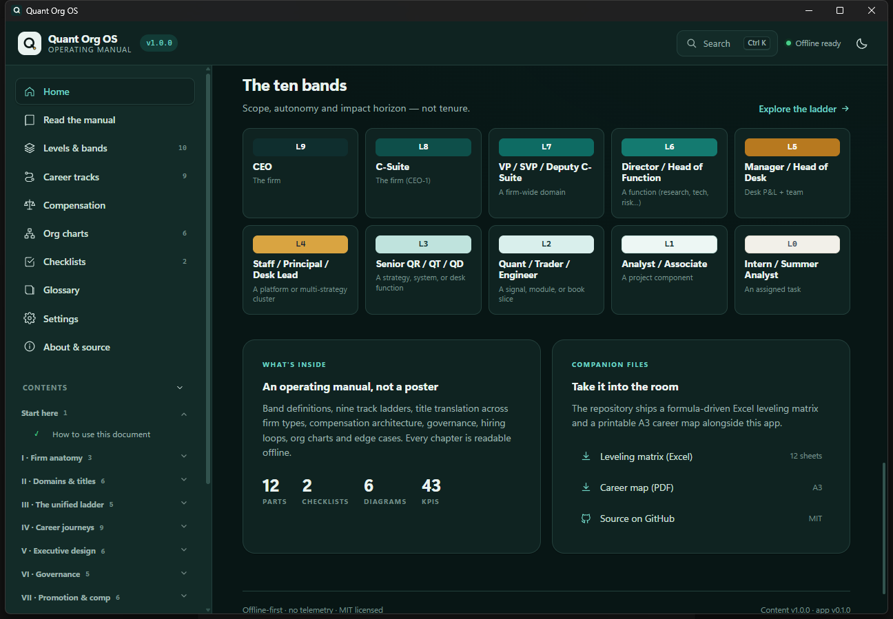

# Quant Org OS

**An offline-first operating manual for quantitative trading firms — as a document, a workbook, a printable career map, and a tiny cross-platform app.**

Nine tracks. Ten bands. One firm. The framework describes how an algorithmic
trading firm is organised from L0 to L9, how people grow inside it, how
compensation is built from relative bands, and how decisions are made when the
firm is 40 people and when it is 400.

The app is a Rust/Tauri shell around a self-contained content bundle. It opens
and works with no network, on a plane, on a locked-down desktop, or on a phone.
Updates are optional and verified.

---

## What is in the box

| Artefact | Path | What it is |
| --- | --- | --- |
| Framework | `quant-org-career-framework.md` | The canonical document: 51 sections, 8 appendices, a start-here chapter and a closing. All 59 core documents plus the wrappers. |
| Leveling matrix | `quant-org-leveling-matrix.xlsx` | Twelve formula-driven sheets: levels, tracks, comp bands, comp builder, calibration, org plan, promotion, KPIs, title map, glossary. |
| Career map | `career-map.html` / `quant-org-career-map.pdf` / `quant-org-career-map.png` | Printable one-page ladder, track and decision-point map. |
| Portable build | `dist/quant-org-os-*-windows-portable.zip` | One-executable Windows build produced by `tools/make_portable.ps1`. |
| Calibration guide | `docs/CALIBRATION.md` | Anchors, ratios, a 60-minute agenda, worked example, failure modes and a decision record. |
| App | `ui/`, `src-tauri/` | Tauri 2 desktop (Windows, macOS) and mobile (Android) app. |
| Content pipeline | `tools/` | Markdown → seed bundle → app; plus Excel, SVG, career map and update manifest generators. |

The app contains **61 reading units**: 51 numbered sections, appendices A–H,
a start-here chapter and a closing chapter. Everything below is available
offline on first launch. The 59 core documents (51 + 8) are indexed in
[`docs/DOCUMENT-MAP.md`](docs/DOCUMENT-MAP.md).

- Firm anatomy, the seven pillars, and the retained Operations function.
- The original core domains and ranks, preserved verbatim and expanded.
- A unified **L0–L9** ladder with title translation to HFT, multi-strat, bank,
  big-tech and crypto firms.
- Nine tracks: Research, Trading, Technology, Data/ML, Risk & Validation,
  Compliance & Legal, Finance & Treasury, Operations, Product & Business.
- Every manager and C-suite level, with journeys, gates and failure modes.
- Relative compensation architecture: base / bonus / PnL share / equity mix and
  multipliers, never absolute salaries.
- Governance, decision rights, promotion evidence, hiring loops, org charts,
  scaling playbooks, edge cases and a full decision record.

## Download

Release binaries are produced by the workflows in `.github/workflows/` and
attached to a tagged GitHub release. Until a release exists, build from source
(below); the portable Windows build is a single command.

- **Windows (portable)** — `.zip` containing one executable. Unpack and run; no
  installer, no admin rights. Settings and content live in
  `%APPDATA%\com.quantorg.os`.
- **Windows (installer)** — `.msi` or NSIS `-setup.exe`, built by the release
  workflow. WebView2 is used if present; the installer can fetch the Evergreen
  runtime when it is missing.
- **macOS** — universal `.dmg` (Apple silicon + Intel). Unsigned builds need
  right-click → Open the first time, or `xattr -dr com.apple.quarantine` on the
  app bundle.
- **Android** — `.apk` (debug-signed in CI, installable with sideloading). A
  release build with your own keystore is documented in `docs/BUILDING.md`.

Prefer a browser? The Pages workflow publishes a read-only web preview of the
same content; no install, no account.



## Run from source

Prerequisites: Node 20+, Rust stable, and the platform prerequisites in
[`docs/BUILDING.md`](docs/BUILDING.md).

```bash
npm ci
npm run dev          # desktop dev window with hot reload of ui/
npm run build        # optimized desktop bundle (installers need WiX/NSIS once)
npm test             # Rust unit tests (12)
python tools/verify_content.py
```

A portable Windows zip can be assembled from an existing release executable
without the installer toolchains:

```powershell
powershell -ExecutionPolicy Bypass -File tools/make_portable.ps1
```

The frontend can also be reviewed without Rust:

```bash
python -m http.server 8765 --bind 127.0.0.1
# open http://127.0.0.1:8765/ui/index.html
```

In browser mode, settings and progress use `localStorage`; update checks are
simulated and clearly labelled.

Android:

```bash
npm run android:init     # once, requires Android SDK + NDK
npm run android:build    # debug APK by default
```

## The app

- **Read** — a quiet, typographic reader with a table of contents, previous/
  next navigation, reading progress, and deep links (`#/read/ch-38`).
- **Levels** — all ten bands with mission, scope, ownership, people, horizon
  and promotion criteria.
- **Tracks** — nine ladders with journeys, branches, lateral moves, failure
  modes and promotion evidence.
- **Compensation** — a relative builder: pick band, track and performance
  multiple; see base / bonus / LTI / total shape without absolute numbers.
- **Org** — six SVG charts (current state, scale-up, multi-pod, desk, research
  pod, platform) with pan, zoom, fit, focus, fullscreen, SVG download and print.
- **Checklists** — calibration and operating checklists with saved progress.
- **Glossary** — 67 terms, searchable and linked.
- **Search** — `Ctrl/⌘ + K` across every chapter with keyboard navigation.
- **Settings** — theme (system/light/dark/sepia), type scale, density, reduced
  motion, default view, update channel, content rollback and reset.
- **About & diagnostics** — versions, content hash, data folder, one-click
  copy/save of a diagnostics report.

Keyboard: `Ctrl/⌘ K` or `/` opens search, arrow keys move, `Enter` opens,
`Esc` closes overlays. Every control is reachable by keyboard and labelled for
screen readers.

## Offline and updates

On first launch the app installs the compiled-in seed into its data folder.
No network call is required to read anything. The update check is explicit (or
on an opt-in interval) and follows a strict protocol:

1. Fetch a small JSON manifest over HTTPS (ETag-aware, redirects capped and
   re-validated at every hop).
2. Validate schema, versions, sizes, hash format, URL scheme and host
   allowlist.
3. Stream the bundle with a hard size cap and hash it while it arrives.
4. Verify SHA-256, then validate the bundle's structure before touching the
   installed copy.
5. Swap atomically; keep the previous bundle for rollback.

If the disk is full, the network drops, the manifest is malformed, the hash
does not match, or the app is offline, the installed content stays untouched
and the error is shown with a retry path. A corrupted installed bundle is
recovered from the previous bundle, then from the embedded seed, at startup.

Details, manifest schema and publishing steps:
[`docs/OFFLINE-AND-UPDATES.md`](docs/OFFLINE-AND-UPDATES.md).

## Repository layout

```text
quant-org-os/
├── quant-org-career-framework.md    # canonical content
├── quant-org-leveling-matrix.xlsx   # generated workbook
├── career-map.html / .pdf / .png    # generated career map
├── docs/                            # calibration, architecture, build, QA
├── ui/                              # dependency-free frontend
│   ├── index.html
│   ├── css/app.css
│   └── js/{app.js,markdown.js}
├── src-tauri/                       # Rust shell, content store, updates
│   ├── src/{lib,main,commands,content,settings,update}.rs
│   ├── resources/seed.json          # generated, embedded at compile time
│   ├── resources/diagrams/*.svg
│   └── tauri.conf.json
├── tools/                           # content + artefact generators
├── updates/manifest.json            # published update pointer
└── .github/workflows/               # CI, releases, Pages preview
```

## Building and contributing

- [`docs/BUILDING.md`](docs/BUILDING.md) — Windows (MSVC and GNU), macOS,
  Android, signing, troubleshooting.
- [`docs/ARCHITECTURE.md`](docs/ARCHITECTURE.md) — layers, data flow, state,
  security boundaries and failure handling.
- [`docs/CONTENT-PIPELINE.md`](docs/CONTENT-PIPELINE.md) — how the document
  becomes the app bundle and the workbook.
- [`docs/DOCUMENT-MAP.md`](docs/DOCUMENT-MAP.md) — all 59 core documents, their
  parts, reading paths and app coverage.
- [`docs/QA-CHECKLIST.md`](docs/QA-CHECKLIST.md) — manual release checks
  including offline, rollback and small-screen cases.
- [`docs/PUBLISHING.md`](docs/PUBLISHING.md) — create the GitHub repository,
  push, tag a release, enable Pages and publish content updates.
- [`CONTRIBUTING.md`](CONTRIBUTING.md) — editorial rules and the check list.
- [`SECURITY.md`](SECURITY.md) — threat model and private reporting.

## Scope and honesty

This is a design and calibration tool, not legal, tax, immigration or
investment advice. Compensation is deliberately relative: multipliers and mix,
not salaries. Jurisdiction-specific employment law, comp regulation, licensing
and data protection must be reviewed by qualified counsel where you operate.
The framework names one archetype (a sub-100-person HFT/algo firm) and gives
scaling notes for 100–250 and 250–500 people; it is not a universal law of
organisation.

## License

MIT. See [`LICENSE`](LICENSE). Content and diagrams are released under the same
license.
