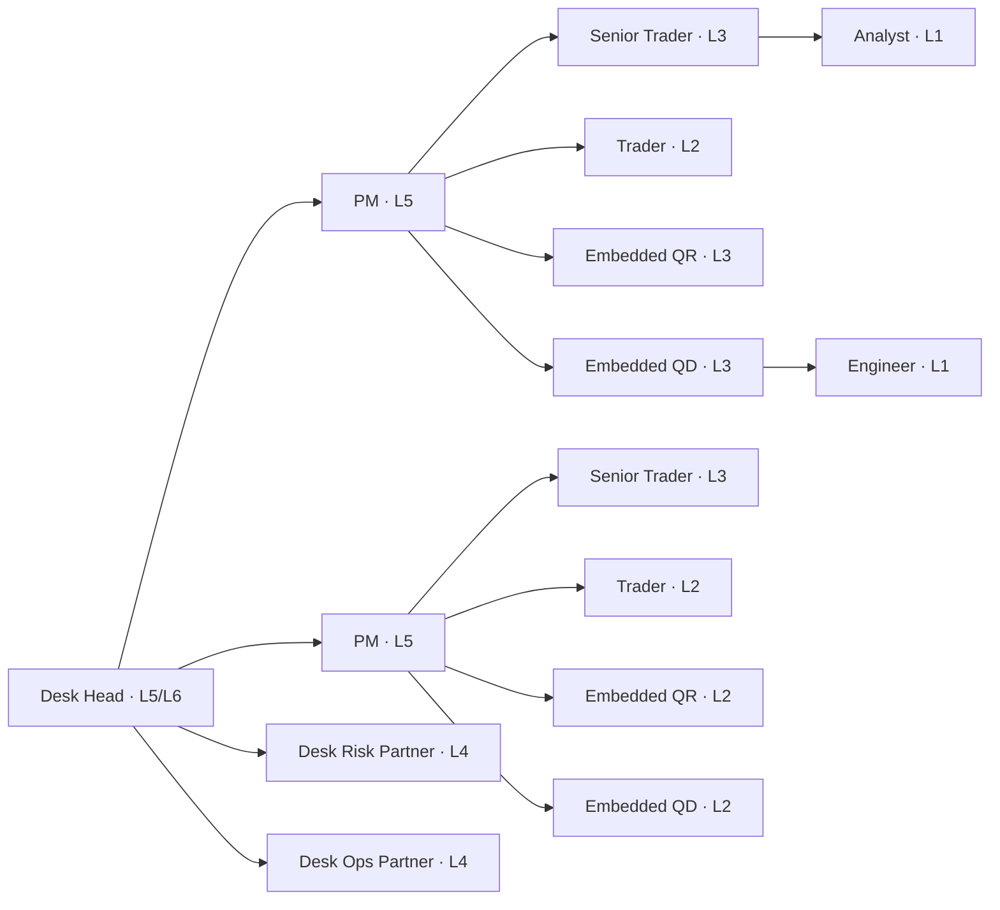
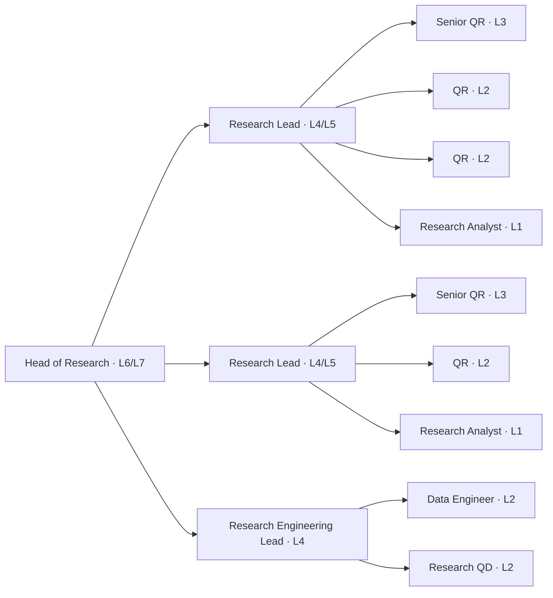
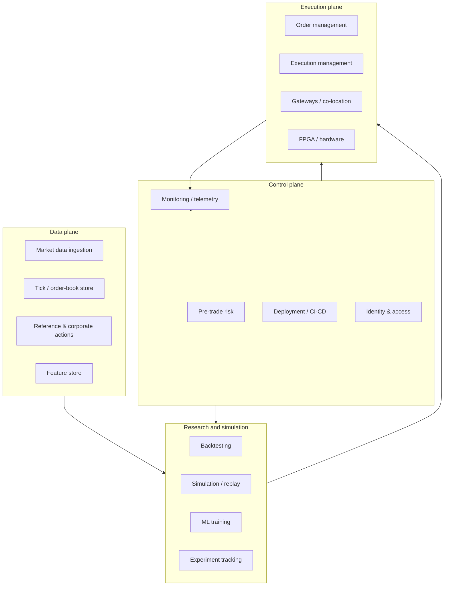

# The Quant Firm Operating System

### Organization Design, Leveling & Career Journeys for an Algorithmic Trading Business
**Version 1.0 · November 2026 · <100-person firm, scalable to 500+**

---

## How to use this document

This is the operating manual for how a quant trading firm is structured, how people grow, and how decisions get made. It is written for three audiences:

- **Founders / CEO:** the target org, the C-suite design, the governance and capital-allocation machinery.
- **Managers / Heads of Desk / Heads of Function:** the level definitions, promotion gates, KPIs, and hiring bars you will apply.
- **Individual contributors (QR, QT, QD, data, risk, ops):** the journey map for your track — what "next level" actually means, and the evidence required.

**Three rules for reading it:**

1. **Levels are scope, not seniority theater.** A level describes what you own, what you may decide alone, and over what horizon — not how long you've been around.
2. **Titles are local; bands are universal.** Every firm names things differently. The L0–L9 bands let you compare a Senior QR at an HFT prop shop with a VP at a bank and a Staff engineer at a big-tech firm.
3. **The map is not the territory.** Use the journeys as a default, then adapt to your firm's strategy, market, and regulatory footprint.

> **Scope note (per brief):** HR and HR-adjacent job families (recruiting, talent, people ops, L&D, benefits/compensation administration, HRBPs) are **excluded**. People *processes* — promotion calibration, compensation philosophy, performance reviews — remain, because they are manager and CEO responsibilities and cannot be separated from a career framework.

---

## Table of contents

**Part I — Firm Anatomy & Design Principles**
1. The <100-person algo trading firm
2. Scaling stages: 100–250 and 250–500
3. Ten design principles

**Part II — Core Domains & Job Titles (preserved & expanded)**
4. Research & Strategy
5. Trading & Portfolio Management
6. Software, Low-Latency & Hardware Engineering
7. Data, Risk & Control
8. Operations & Corporate Functions
9. Product & Business (new)

**Part III — The Unified Leveling System**
10. Why one ladder
11. The ten bands at a glance
12. Band-by-band definitions (L0–L9)
13. Title translation matrix
14. Time-in-level and promotion philosophy

**Part IV — Career Journeys by Track**
15. Research track
16. Trading track
17. Technology track
18. Data & ML Engineering track
19. Risk & Model Validation track
20. Compliance & Legal track
21. Finance & Treasury track
22. Operations track
23. Product & Business track

**Part V — Executive & C-Suite Design**
24. The CEO
25. The functional C-suite (CTO, CRO, CFO, COO, CCO/GC, CDO, Chief Scientist, Chief Trading Officer)
26. Minimum-viable vs scaled C-suite
27. CEO succession and founder transitions
28. Product & Business leadership
29. The executive team operating cadence

**Part VI — Governance & Decision Rights**
30. Committees and their charters
31. RACI for the decisions that matter
32. Strategy lifecycle and capital allocation
33. Risk limits, model risk, incidents
34. Separation of duties

**Part VII — Promotion, Performance & Compensation**
35. Performance philosophy by track
36. The promotion process and calibration committee
37. The IC vs management dual track
38. Compensation architecture (relative structure)
39. Retention, deferrals, clawbacks, garden leave
40. Underperformance and exits

**Part VIII — Hiring & Interview Loops**
41. Loop design by track
42. Entry points and level calibration
43. Scorecards and the hiring bar

**Part IX — Org Charts**
44. Current state (<100)
45. Scale-up (100–250)
46. Multi-pod / multi-office (250–500)
47. Internal views: desk, research pod, platform

**Part X — Scaling Playbook & Edge Cases**
48. When to add each C-suite role
49. Business-model variants (HFT, multi-strat, bank, crypto)
50. Multi-office, remote/hybrid, and regulatory notes
51. Anti-patterns

**Appendices**
A. One-page cheat sheet
B. Level & title glossary
C. Promotion packet template
D. 90-day onboarding plans
E. Interview question bank
F. KPI dictionary
G. Further reading
H. Original source text (preserved verbatim)

---

# PART I — FIRM ANATOMY & DESIGN PRINCIPLES

## 1. The <100-person algo trading firm

The reference organization is the attached chart: a CEO over five pillars — **HR & Operations, Strategies, Research, Technology, Risk & Compliance** — with roughly 40–60 people in the core value chain.

```
                                   ┌─────────┐
                                   │   CEO   │
                                   └────┬────┘
        ┌───────────────┬───────────────┼───────────────┬────────────────┐
        │               │               │               │                │
 ┌──────┴──────┐ ┌──────┴──────┐ ┌──────┴──────┐ ┌──────┴──────┐ ┌───────┴───────┐
 │Head of HR & │ │Head of      │ │Head of      │ │Head of      │ │Head of Risk & │
 │Operations   │ │Strategies   │ │Research     │ │Technology   │ │Compliance     │
 │(HR excluded)│ │             │ │             │ │             │ │               │
 └──────┬──────┘ └──────┬──────┘ └──────┬──────┘ └──────┬──────┘ └───────┬───────┘
        │               │               │               │                │
   Admin / Ops     Team 1..4        Lead, ML        Lead, Infra       Lead 1, Risk
   Product Mgr 1/2  (Trading Desk)   Portfolio Opt.  Lead, Co-loc.     Lead 2, Risk
                                     Market Micro.   Lead 1, Software
                                                     Lead 2, Software
```

**Reading the chart correctly:**

- **Strategies** is the commercial engine: four small trading teams, each a mix of traders, QRs, QDs, and C++ engineers. Each team is a proto-P&L pod.
- **Research** is the factory that feeds Strategies: ML, portfolio optimization, and market microstructure are *shared* research capabilities, not desk-owned.
- **Technology** is split between infrastructure/co-location (the latency backbone) and software (the application layer).
- **Risk & Compliance** is deliberately independent of Strategies — the person who can say "no" to the desk must not report to the desk.
- **HR & Operations** combines two very different functions. Per the brief, HR is excluded from this framework; Operations is retained and expanded as its own pillar.
- **The color legend** in the source chart maps people to role families: traders, quant researchers, quant developers, software engineers, C++ engineers, risk analysts. In this document we generalize those into **tracks** with full ladders.

**What the chart gets right (keep it):**
- Small, autonomous trading teams with clear ownership.
- Research as a shared capability, not a cost center.
- Risk independent from trading.
- A flat span of control (CEO → Head → Lead → IC).

**What the chart leaves implicit (this document makes explicit):**
- How an intern becomes a Head of Desk.
- What separates a Senior QR from a Staff QR.
- Who owns capital allocation, model deployment, and incidents.
- How the firm scales past 100 without turning into a bank.

## 2. Scaling stages: 100–250 and 250–500

| Dimension | <100 (current) | 100–250 (scale-up) | 250–500 (multi-pod / multi-office) |
|---|---|---|---|
| **C-suite** | CEO + 4–6 heads; some player-coaches | CEO + CTO, CRO, CFO, COO, CCO/GC; CDO emerging | Full C-suite + Chief Scientist, CISO, CBO/CSO; regional heads |
| **Trading** | 4 desk pods, one Head of Strategies | 8–15 pods, 2–3 desk heads, central risk | Multi-strat pods, PMs with capital budgets, independent risk |
| **Research** | One Head of Research, 3 sub-leads | Research pods aligned to horizons; research engineering | Central research + desk-embedded researchers; formal model risk |
| **Technology** | Infra + software + co-lo, ~10–20 engineers | Platform teams, SRE, security, dedicated low-latency group | Multi-site, hardware lab, formal architecture review board |
| **Data** | Data engineering embedded in tech | Dedicated data platform + ML engineering | Data mesh / lakehouse, governance, lineage, CDO |
| **Risk** | 2–4 risk analysts, Head of Risk | Market/credit/liquidity split, model validation | Independent model risk, stress testing, scenario library |
| **Compliance/Legal** | Combined Head of Risk & Compliance | Separate Compliance + Legal | CCO + GC + surveillance + regulatory affairs |
| **Finance** | Outsourced accounting + CFO-as-needed | Full finance team, treasury | Treasury desk, FP&A, tax, capital planning |
| **Operations** | Trade ops + exchange connectivity | Dedicated market ops, corporate actions | 24/6 global ops, incident command |
| **Product/Business** | Product managers for internal tools | Product + exchange partnerships | Product org + investor relations + corp dev |

**The scaling rule:** add a **management layer** only when a Head is managing more than ~7 people or more than 2 distinct workflows. Add a **C-suite role** only when the function has firm-wide decision rights (capital, risk, technology architecture, regulatory). Otherwise, keep it as a Head-of-Function at L6.

## 3. Ten design principles

1. **P&L proximity, not P&L theater.** Every role should be able to point to the number it moves: net Sharpe, latency percentile, reconciliation break rate, validation finding severity. Support functions measure *risk avoided* and *capacity created*, not activity.
2. **Small autonomous pods with shared rails.** Trading teams own their strategies; research, data, and infrastructure are shared platforms so pods don't rebuild the same wheels.
3. **Risk has a veto, not a vote.** The CRO can block a strategy launch or limit increase; the desk can escalate to the CEO, but cannot override unilaterally.
4. **One ladder, many tracks.** A Senior QR, Senior QT, and Senior QD sit at the same band and should be comparable in scope, compensation logic, and promotion rigor.
5. **Dual track is real.** Staff/Principal ICs are not "failed managers." They are the technical spine of the firm and are paid accordingly.
6. **Promotion is evidence-based and calibrated.** No level is granted for tenure; every promotion has a written packet, a sponsor, and a calibration committee.
7. **Separation of duties.** Research proposes, risk validates, execution deploys, finance reconciles. No single person owns the whole chain for a live strategy.
8. **Information flows to the decision.** The person closest to the data makes the call, within explicit limits; escalation is for *exceptions*, not routine approvals.
9. **Latency and reliability are product features.** Technology is not a cost center; it is the execution edge. SRE and low-latency engineers sit at the same table as traders.
10. **Scale the organization, not the bureaucracy.** Every new process must replace a worse process or remove a bottleneck. If it only adds control, it needs a sunset clause.

# PART II — CORE DOMAINS & JOB TITLES (preserved & expanded)

> Your original taxonomy is retained below as the canonical spine. Each domain now gains: a mission statement, role-by-role scope, interfaces, "what good looks like," and the bands where the roles live.

## 4. Research & Strategy

**Mission:** convert data into repeatable, risk-adjusted predictive signals and portfolio decisions.

| Role | One-line scope | Primary interfaces | Typical bands |
|---|---|---|---|
| **Quantitative Researcher (QR) / Alpha Researcher** | Builds statistical, econometric, and ML models to predict short-term price moves and microstructure signals | Data, QD, QT, risk | L1–L8 |
| **Execution / Microstructure Researcher** | Studies order-book dynamics, queue position, slippage, optimal routing | Execution traders, low-latency engineers, exchange connectivity | L2–L7 |
| **Data Quant / Alternative Data Researcher** | Sources, cleans, and models tick data, order books, news, and alternative datasets | Data engineering, compliance (vendor licensing) | L1–L7 |
| **ML Researcher** *(added)* | Develops deep learning, representation learning, and NLP models for alpha and regime detection | QR, data/ML platform | L2–L8 |
| **Portfolio Optimization Researcher** *(added)* | Turns raw signals into portfolio weights under risk, cost, and capacity constraints | QR, risk, treasury | L2–L8 |
| **Research Engineer** *(added)* | Builds the research platform: backtesting, feature stores, experiment tracking, reproducibility | QD, data platform | L1–L6 |

**What the domain owns:** the research agenda, the signal library, the backtesting standard, the research review cadence, and the "kill list" of dead ideas.

**What good looks like:**
- Every signal has a documented hypothesis, data lineage, out-of-sample protocol, capacity estimate, and decay monitoring.
- Research review is adversarial but blameless: the goal is to kill weak ideas cheaply.
- A QR can explain *why* a signal should work, not just that it backtested well.

**Interfaces and handoffs:** Research → Strategies: a signal graduates through a **signal readiness review** (documentation, OOS results, capacity, risk limits). Research → Technology: production requirements (latency, data volume, update frequency). Research → Risk: model assumptions and failure modes.

**Common failure modes:** backtest overfitting, data leakage, ignoring transaction costs, signals that work only in one regime, research that never ships.

## 5. Trading & Portfolio Management

**Mission:** deploy capital profitably and safely in live markets, and manage the risk of the book in real time.

| Role | One-line scope | Primary interfaces | Typical bands |
|---|---|---|---|
| **Quantitative Trader (QT)** | Runs live strategies, monitors risk and P&L, tunes parameters, manages intraday/short-horizon exposures | QR, QD, risk, ops | L1–L8 |
| **Execution Trader** | Low-impact order execution, liquidity provision, market making across exchanges | Microstructure research, low-latency tech, exchange connectivity | L1–L7 |
| **Portfolio Manager (PM) / Quant PM** | Owns P&L for a book or strategy pod, allocates capital and risk limits, leads researchers/traders | CEO/CRO, desk heads, research | L4–L8 |
| **Market Maker** *(added)* | Quotes two-sided markets, manages inventory and adverse selection | Execution tech, risk, microstructure research | L1–L7 |
| **Desk Head** *(added)* | Runs a desk of 2–5 pods; owns aggregate P&L and capital deployment within limits | Head of Strategies, CRO, CFO | L5–L7 |

**What the domain owns:** live P&L, fill quality, inventory, execution costs, strategy parameter tuning, and the trading calendar.

**What good looks like:**
- Traders know their **risk budget** and **capacity** as precisely as their P&L.
- Execution is measured against a benchmark (arrival price, VWAP, implementation shortfall) — not just "did it fill."
- A trader can explain the strategy's edge, its failure regime, and the kill switch.

**Interfaces:** Strategies ↔ Research (signal handoff), Strategies ↔ Risk (limits, stress), Strategies ↔ Ops (connectivity, corporate actions), Strategies ↔ Finance (P&L attribution, treasury).

**Common failure modes:** overriding risk limits in the heat of the moment, position sizing by conviction instead of risk, ignoring capacity, mistaking beta for alpha, revenge trading after a drawdown.

## 6. Software, Low-Latency & Hardware Engineering

**Mission:** turn research and trading logic into fast, reliable, observable production systems — and keep them running when markets misbehave.

| Role | One-line scope | Primary interfaces | Typical bands |
|---|---|---|---|
| **Quantitative Developer (QD)** | Production code for models, pricing, backtesting, and trading logic (C++, Rust, Python) | QR, QT, platform | L1–L8 |
| **Low-Latency / HFT Systems Engineer** | Kernel bypass, networking, lock-free concurrency, tick-to-trade latency | Co-location, exchange connectivity, traders | L2–L8 |
| **FPGA / Hardware Engineer** | Verilog/VHDL/FPGA for market-data decoding and order execution | Low-latency, exchanges, hardware vendors | L2–L8 |
| **Core / Infrastructure / SRE / DevOps Engineer** | Distributed compute, simulation/backtesting pipelines, telemetry, production reliability | Everyone | L1–L8 |
| **Security Engineer** *(added)* | Application security, secrets, access control, incident response | CTO, compliance, ops | L2–L7 |
| **Build / Release Engineer** *(added)* | CI/CD, reproducible builds, deployment orchestration | QD, SRE | L1–L6 |

**What the domain owns:** the production platform, latency SLOs, uptime, deployment safety, observability, and the technology roadmap.

**What good looks like:**
- p99 latency and jitter are tracked like P&L; regressions trigger alerts, not post-mortems a week later.
- Every production change is reproducible, reversible, and tested in simulation.
- On-call is humane: alerts are actionable, runbooks exist, and incidents produce fixes, not blame.

**Interfaces:** Technology ↔ Research (research compute, backtesting), Technology ↔ Trading (execution, market data), Technology ↔ Risk (risk checks in the order path), Technology ↔ Ops (connectivity, exchange certifications).

**Common failure modes:** optimizing the wrong percentile, hero-driven operations, untested failover, configuration drift, "it works on my machine" deployments.

## 7. Data, Risk & Control

**Mission:** make data trustworthy, make risk visible, and make the control environment independent.

| Role | One-line scope | Primary interfaces | Typical bands |
|---|---|---|---|
| **Data Engineer / Machine Learning Engineer** | Petabyte-scale tick storage, feature pipelines, ML training infrastructure | Research, technology, compliance | L1–L8 |
| **Quantitative Risk Manager / Risk Engineer** | Real-time exposure, stress tests, tail risk, margin/position limits, model validation | Trading, research, finance | L1–L8 |
| **Model Validation Quant** | Independently tests pricing, risk, and statistical assumptions for accuracy and robustness | Research, risk, compliance | L2–L7 |
| **Market Risk Analyst** *(added)* | Monitors delta/vega/gamma, concentration, liquidity, and scenario P&L | Desk, risk | L1–L6 |
| **Credit / Counterparty Risk Analyst** *(added)* | Exchange, prime broker, and counterparty exposure | Treasury, risk, legal | L1–L6 |
| **Liquidity Risk Analyst** *(added)* | Funding liquidity, margin calls, stress liquidity | Treasury, risk | L1–L6 |
| **Compliance / Surveillance Analyst** *(added)* | Trade surveillance, market-abuse monitoring, regulatory reporting | Compliance, legal, trading | L1–L7 |

**What the domain owns:** the risk framework, limits, stress library, data quality SLAs, and independent validation.

**What good looks like:**
- Risk limits are **pre-trade**, not post-hoc reports.
- Every model has an independent validation memo with assumptions, limitations, and failure modes.
- Data has lineage, freshness SLAs, and reconciliation against exchange records.
- Compliance can reconstruct any order's lifecycle from immutable logs.

**Interfaces:** Risk ↔ Trading (limits, stress), Risk ↔ Research (model assumptions), Data ↔ everyone, Compliance ↔ trading/legal/regulators.

**Common failure modes:** risk reports that arrive after the loss, stale data silently used in production, validation that rubber-stamps, compliance treated as a paperwork function.

## 8. Operations & Corporate Functions

**Mission:** keep the firm's plumbing working — connectivity, settlements, reconciliations, treasury, accounting, legal — so the front office can focus on markets.

| Role | One-line scope | Primary interfaces | Typical bands |
|---|---|---|---|
| **Trading Operations / Market Ops** | Exchange connectivity, corporate actions, reconciliations, live incident response | Trading, technology, exchanges | L1–L7 |
| **Compliance, Legal & Finance** | Regulatory reporting, exchange rules, treasury, firm accounting | CEO, risk, regulators | L1–L8 |
| **Treasury Analyst / Dealer** *(added)* | Cash, collateral, margin, FX, funding | CFO, risk, prime brokers | L1–L7 |
| **Financial Analyst / Controller** *(added)* | P&L attribution, month-end close, tax, audit | CFO, trading, ops | L1–L7 |
| **Corporate Development / Strategy** *(added)* | Partnerships, acquisitions, exchange deals, new-market entry | CEO, CFO, legal | L2–L7 |
| **Office of the CEO / Chief of Staff** *(added)* | Cross-functional execution, board materials, special projects | CEO, C-suite | L3–L7 |

**What the domain owns:** operational reliability, regulatory standing, financial integrity, and corporate infrastructure.

**What good looks like:**
- Reconciliations break rarely; when they do, they are resolved same-day with root cause.
- Exchange certifications and rule changes are tracked ahead of deadlines.
- The books close on time and P&L is attributable to strategy, desk, and instrument.
- Legal and compliance are consulted *before* new products launch, not after.

**Interfaces:** Ops ↔ Trading/Tech (connectivity, incidents), Finance ↔ all (P&L, budgets), Legal/Compliance ↔ product and trading (new markets, licensing), Corp Dev ↔ CEO/CFO.

**Common failure modes:** manual processes that only one person understands, reconciliation debt, regulatory surprises, treasury surprises on margin calls.

## 9. Product & Business (new)

**Mission:** make the firm's internal platforms usable and its external commercial relationships productive.

| Role | One-line scope | Primary interfaces | Typical bands |
|---|---|---|---|
| **Product Manager (internal platforms)** | Owns the roadmap for research, execution, and data platforms; translates desk needs into product requirements | Research, tech, trading | L2–L7 |
| **Business Development / Exchange Partnerships** | Negotiates connectivity, fee schedules, market-data licenses, and strategic partnerships | CEO, CFO, legal, ops | L2–L8 |
| **Investor Relations / Capital Raising** *(scaled firm)* | Manages LP relationships, fundraising, and reporting | CEO, CFO, compliance | L4–L8 |
| **Chief Business Officer / Chief Strategy Officer** *(scaled firm)* | Owns corporate strategy, partnerships, and growth | CEO, C-suite | L8 |

**What the domain owns:** platform adoption, commercial terms, strategic partnerships, and (when applicable) capital relationships.

**What good looks like:**
- Product decisions are backed by usage data and desk interviews, not opinion.
- Exchange and vendor economics are renegotiated on a schedule, not when a contract expires.
- External partners see one firm, not five competing internal voices.

**Interfaces:** Product ↔ tech/research/trading; BD ↔ CEO/CFO/legal/ops; IR ↔ CEO/CFO/compliance.

**Common failure modes:** product managers without decision rights, BD deals that create operational debt, IR promises the firm cannot operationally deliver.

# PART III — THE UNIFIED LEVELING SYSTEM

## 10. Why one ladder

Firms usually have three incompatible ladders: researchers get "Senior → Staff," traders get "Junior → Senior → PM," engineers get "L3 → L8." That makes compensation arguments incoherent and lets a "VP" at a bank outrank a "Head of Desk" at a prop shop on paper while doing less.

The unified ladder fixes this with **one currency: scope × autonomy × impact horizon × decision rights**. Titles still vary by track; the band does not. Every band answers five questions:

1. **What do you own?** (task → module → strategy → desk → function → firm)
2. **What can you decide alone?** (execute → propose → own → allocate → govern)
3. **Over what horizon?** (days → weeks → months → quarters → years)
4. **Whom do you grow?** (self → juniors → project teams → managers → the firm)
5. **What evidence proves you're ready for the next band?**

## 11. The ten bands at a glance

| Band | Firm-facing title | Owns | Autonomy | Horizon | People | Comp shape |
|---|---|---|---|---|---|---|
| **L0** | Intern / Summer Analyst | An assigned task | Supervised | Days–weeks | — | Stipend |
| **L1** | Analyst / Associate | A project component | Guided | Weeks | — | Base + bonus |
| **L2** | Quant / Trader / Engineer | A signal, module, or book slice | Independent | Weeks–months | Mentors juniors | Base + bonus |
| **L3** | Senior QR / QT / QD | A strategy, system, or desk function | Sets own priorities | Months | Leads projects | Base + bonus + impact award |
| **L4** | Staff / Principal / Desk Lead | A platform or multi-strategy cluster | Sets direction | Quarters | Leads 3–10 ICs | + PnL share / equity |
| **L5** | Manager / Head of Desk | Desk P&L + team | Allocates within limits | Quarters–years | Manages ICs | PnL share + equity |
| **L6** | Director / Head of Function | A function (research, tech, risk…) | Owns function strategy | Years | Manages managers | Profit pool + equity |
| **L7** | VP / SVP / Deputy C-Suite | A firm-wide domain | Sets firm policy | Years | Org-wide influence | Equity |
| **L8** | C-Suite | The firm (CEO-1) | CEO-1 authority | Years | Whole function | Equity + LTIP |
| **L9** | CEO | The firm | Board-level | Multi-year | The firm | Equity |

**Two important calibrations:**

- **L4 is a real fork.** Staff/Principal ICs and Desk Leads both sit here. One scales technical depth; the other scales people and P&L. Neither is "above" the other.
- **L7 is a bridge band.** It exists so a Deputy CTO or SVP Research can own a firm-wide domain without being on the executive team. In a <100-person firm, L7 may be empty; in a 250+ firm, it is where regional heads and deputies live.

### The original seven-rank ladder (preserved)

> The firm's original taxonomy is retained below, close to verbatim. The right-hand column maps each rank to the unified band so the old language and the new ladder can coexist. "Exact titles vary by firm, but most HFT and quant shops follow a flat-to-tiered meritocratic ladder tied closely to P&L or technical impact."

1. **Intern / Summer Analyst:** Short-term research, trading simulation, or coding projects; primary pipeline for full-time offers. → **L0**
2. **Junior / Associate / Analyst (Entry-Level, ~0–2 yrs):** Executes defined research tasks, builds basic tools, or assists on live trading desks under supervision. → **L1**
3. **Mid-Level Quant / Trader / Developer (~2–5 yrs):** Independently owns signals, trading books, or core low-latency systems. → **L2**
4. **Senior Quant / Senior Trader / Senior Engineer (~5+ yrs):** Leads complex strategies or mission-critical infrastructure and mentors junior staff. → **L3**
5. **Vice President (VP) / Director / Principal:** Used more often at banks and larger multi-strat funds; denotes high technical or desk authority. → **L4–L6**, calibrated by scope (a bank VP is often L4; a Director is L5–L6)
6. **Portfolio Manager (PM) / Head of Desk:** Runs a standalone profit center or team with explicit capital and risk budgets. → **L5**
7. **Managing Director (MD) / Partner / C-Suite (CEO, CTO, CRO, Head of Quant):** Shapes firm-wide strategy, capital allocation, risk governance, and leadership. → **L7–L9**

**Why the mapping is not one-to-one:** the original ladder mixes *technical seniority* (Principal), *bank hierarchy* (VP, Director, MD), and *P&L ownership* (PM, Head of Desk). The unified bands separate those dimensions, so a "VP" and a "Head of Desk" can be compared on scope rather than title. This is also why the title-translation matrix in §13 matters: it lets you hire laterally without importing someone else's hierarchy by accident.

## 12. Band-by-band definitions

### L0 — Intern / Summer Analyst

**Mission:** prove you can learn fast, work with data, and communicate clearly.

- **Scope:** one well-defined project with a named supervisor and a written brief.
- **Autonomy:** supervised; you ask before changing direction.
- **Deliverables:** a working analysis, notebook, or tool; a short presentation; a written handoff.
- **What "good" looks like:** the work is reproducible, the conclusion is honest, and the intern can explain *why* the method was chosen.
- **Promotion signal:** an offer to return at L1 — not because the project succeeded, but because the reasoning and collaboration were sound.
- **Common titles:** Summer Analyst, Research Intern, Trading Intern, Software Engineering Intern.

### L1 — Analyst / Associate (entry level, ~0–2 years)

**Mission:** execute defined work reliably and start forming judgment.

- **Scope:** a component of a larger project — a data pipeline, a backtest module, a risk report, a reconciliation.
- **Autonomy:** guided; the supervisor sets the what, you own the how within agreed bounds.
- **Impact horizon:** weeks.
- **Deliverables:** clean code/analysis, documented assumptions, on-time delivery, clear status updates.
- **Decision rights:** none over capital or production; may propose improvements.
- **Promotion signal:** consistent independent delivery, correct use of statistical/engineering fundamentals, and evidence of *why* not just *what*.
- **Common titles:** Analyst, Associate, Junior Quant, Junior Trader, Graduate Engineer.

### L2 — Quant / Trader / Engineer (mid level, ~2–4 years)

**Mission:** own a meaningful piece of the machine end-to-end.

- **Scope:** one signal, one execution module, one risk model, one platform service, or a slice of a book.
- **Autonomy:** independent on day-to-day decisions; escalates design changes and limit exceptions.
- **Impact horizon:** weeks–months.
- **Deliverables:** a production-quality signal/system with tests, monitoring, documentation; a measurable contribution to P&L, latency, uptime, or risk coverage.
- **Decision rights:** may deploy within sandbox/limits; may approve small technical changes; cannot change firm risk limits.
- **People:** mentors L0–L1; reviews peers' code/analysis.
- **Promotion signal:** owns outcomes, not tasks; handles ambiguity; their work is used by others without rework.
- **Common titles:** Quant Researcher, Quant Trader, Quant Developer, Software Engineer, Data Engineer, Risk Analyst.

### L3 — Senior (QR / QT / QD), ~4–7 years

**Mission:** own a strategy, system, or function that materially moves the firm's numbers.

- **Scope:** a full strategy from hypothesis to production, a critical platform, or a desk function (execution, risk coverage, data platform).
- **Autonomy:** sets own priorities within the mandate; makes technical calls; represents the firm in their domain.
- **Impact horizon:** months.
- **Deliverables:** strategy P&L or platform SLOs; a documented research/engineering agenda; mentorship of L1–L2; cross-team design reviews.
- **Decision rights:** can approve production changes in their domain; can spend within a small budget; can veto unsafe technical choices (with escalation path).
- **People:** leads projects and 1–3 juniors; not yet a people manager.
- **Promotion signal:** repeatable success across more than one project; influence beyond their own work; ability to say "no" with evidence.
- **Common titles:** Senior Quant Researcher, Senior Trader, Senior Software Engineer, Senior Data Engineer, Senior Risk Analyst.

### L4 — Staff / Principal / Desk Lead (~7–10 years)

**Mission:** multiply other people's output — through architecture, strategy, or desk leadership.

- **Scope:** a platform, a multi-strategy cluster, a research program, or a desk of 2–5 pods.
- **Autonomy:** sets direction for the area; negotiates priorities with L5+; owns technical or trading standards.
- **Impact horizon:** quarters.
- **Deliverables:** platform roadmap or strategy cluster P&L; standards, tooling, and reviews that raise the whole team; a pipeline of L2–L3 talent.
- **Decision rights:** allocates technical resources within the area; approves designs; may own a small P&L or cost center.
- **People:** leads 3–10 ICs (directly or matrixed); coaches L3s.
- **Promotion signal:** the area runs better because you exist; you are the person others consult before a major decision; you have built something that outlives your direct involvement.
- **Common titles:** Staff Quant Researcher, Principal Engineer, Staff Data Engineer, Desk Lead, Research Lead.

### L5 — Manager / Head of Desk

**Mission:** own a P&L and the team that produces it.

- **Scope:** a desk (2–5 pods) or a function with a clear mandate and budget.
- **Autonomy:** allocates capital within risk limits; hires/fires (with calibration); sets desk strategy.
- **Impact horizon:** quarters–years.
- **Deliverables:** risk-adjusted P&L; team development; capacity and cost management; strategy pipeline.
- **Decision rights:** capital allocation within limits, position limits within CRO-approved bands, compensation recommendations, vendor spend within budget.
- **People:** manages ICs and L4 leads; builds the bench.
- **Promotion signal:** sustained P&L through different regimes; a team that performs without you in the room; clean risk and compliance record; succession plan in place.
- **Common titles:** Head of Desk, Trading Manager, Research Manager, Engineering Manager, Risk Manager.

### L6 — Director / Head of Function

**Mission:** own a function's strategy and its interface with the rest of the firm.

- **Scope:** Research, Technology, Risk, Data, Finance, Operations, Compliance, or Product — multiple teams and managers.
- **Autonomy:** sets function strategy; owns the budget; represents the function at the executive table.
- **Impact horizon:** years.
- **Deliverables:** function roadmap; talent strategy; cross-functional agreements (SLAs, risk appetite, tech standards); regulatory standing.
- **Decision rights:** function budget, org design, vendor selection, prioritization; co-owns firm-level decisions with C-suite.
- **People:** manages managers; develops L5 successors.
- **Promotion signal:** the function is a competitive advantage, not a support center; peers trust the function's judgment; you can run the firm's agenda in your domain.
- **Common titles:** Head of Research, Head of Technology, Head of Risk, Head of Data, Head of Finance, Head of Operations, Head of Compliance, Director.

### L7 — VP / SVP / Deputy C-Suite

**Mission:** own a firm-wide domain or a major sub-function at scale.

- **Scope:** a domain that spans teams and geographies — e.g., Global Execution, Research Platform, Risk Analytics, Treasury, Legal.
- **Autonomy:** sets policy within the C-suite's mandate; acts for the C-suite officer when delegated.
- **Impact horizon:** years.
- **Deliverables:** firm-wide standards, multi-year roadmap, regulatory relationships, major change programs.
- **Decision rights:** delegated authority from a C-suite officer; represents the firm externally in the domain.
- **People:** leads L6 managers; shapes the leadership pipeline.
- **Promotion signal:** trusted to run the domain without supervision; external recognition; succession-ready for L8.
- **Common titles:** SVP Engineering, VP Risk, Deputy CTO, Global Head of Execution, Head of Legal.

### L8 — C-Suite (CEO-1)

**Mission:** own a firm-wide function and its contribution to firm strategy.

- **Scope:** Technology, Risk, Finance, Operations, Compliance/Legal, Data, Research, Trading, or Business — depending on the firm's structure.
- **Autonomy:** full functional authority; co-owns firm strategy with the CEO and peers.
- **Impact horizon:** years.
- **Deliverables:** functional strategy, capital/risk/tech agenda, regulatory relationships, leadership bench, board reporting.
- **Decision rights:** function budget and org; firm-level policies in the domain; veto rights where the domain requires independence (CRO, CCO).
- **People:** leads the function's leadership team; develops L7 successors.
- **Promotion signal:** the board and CEO trust the function's judgment; the function is audit-clean and strategy-aligned; a credible successor exists.
- **Common titles:** CTO, CRO, CFO, COO, CCO, General Counsel, CDO, Chief Scientist, Head of Strategies/Chief Trading Officer.

### L9 — CEO

**Mission:** set the firm's strategy, allocate capital across businesses, and own the final trade-off between risk and return.

- **Scope:** the entire firm — strategy, capital, people, culture, regulatory standing, board and investor relationships.
- **Autonomy:** board-level; accountable to shareholders/partners.
- **Impact horizon:** multi-year.
- **Deliverables:** firm strategy and capital plan; executive team; risk appetite; external relationships; succession.
- **Decision rights:** final call on capital allocation, M&A, new businesses, C-suite appointments (with board), and firm-wide risk appetite.
- **People:** leads the C-suite; builds the next CEO.
- **Succession signal:** a board-approved successor and a firm that can run without the founder in the room.
- **Common titles:** CEO, Managing Partner, Founder-CEO.

## 13. Title translation matrix

| Band | HFT / prop firm | Multi-strat / hedge fund | Investment bank | Big tech | Crypto / fintech |
|---|---|---|---|---|---|
| L0 | Intern | Summer Analyst | Summer Analyst | Intern | Intern |
| L1 | Analyst / Junior Quant | Analyst | Analyst | L3 / Junior | Analyst |
| L2 | Quant / Trader / Engineer | Associate | Associate / VP-track | L4 | Quant / Engineer |
| L3 | Senior QR/QT/QD | Senior Analyst / Junior PM | VP | L5 | Senior |
| L4 | Staff / Principal / Desk Lead | Senior PM / Pod Lead | Director | L6 (Staff) | Staff / Lead |
| L5 | Head of Desk | PM / Desk Head | Managing Director | L7 (Manager) | Head of Desk |
| L6 | Head of Function | Head of Strategy / COO | MD / Head of Desk | L8 (Senior Manager) | Head of Function |
| L7 | SVP / Deputy C-suite | Sector Head / COO | MD / Global Head | L9 (Director) | VP / SVP |
| L8 | CTO/CRO/CFO/COO/CCO | C-suite / Partner | C-suite / MD | VP / SVP | C-suite |
| L9 | CEO | CIO / Managing Partner | CEO | CEO | CEO |

**How to use the matrix:** when hiring laterally, map the candidate's *scope and decision rights* — not their title — to a band. A bank VP with 30 approvals a day is not automatically an L3; a big-tech Staff engineer who has never touched a P&L may be an L4 technically but an L3 commercially. Calibrate with the band questions in §10.

## 14. Time-in-level and promotion philosophy

| Band | Typical time in level | Promotion cadence | "Up or stay" expectation |
|---|---|---|---|
| L0 | 10–12 weeks | End of internship | Return offer or exit |
| L1 | 18–30 months | Annual | Up to L2 or exit |
| L2 | 24–36 months | Annual | Up to L3 or specialize |
| L3 | 30–48 months | Semi-annual | Up to L4, or stay as senior IC |
| L4 | 3–5 years | Semi-annual | Up to L5, or remain Staff/Principal (no penalty) |
| L5 | 3–5 years | Annual | Up to L6, or remain a strong desk head |
| L6 | 3–5 years | Annual | Up to L7/C-suite, or remain a function head |
| L7 | 3–5 years | Annual | C-suite or senior IC/advisor |
| L8 | 5+ years | Board cycle | CEO or board/advisor |
| L9 | — | Board | Succession |

**Three rules that prevent title inflation:**

1. **No promotion without a written packet** (Appendix C) and a calibration committee.
2. **No level change without a scope change.** If the job is the same, it's a compensation discussion, not a promotion.
3. **Staying is a valid career.** L4 Staff/Principal and L5 Head of Desk are terminal-by-choice levels with full comp and respect. Not everyone should be pushed into management.

**The "up or stay" conversation:** at every review, the manager must ask: *"Do you want the next band, or do you want to deepen this one?"* Both answers are legitimate. The firm's job is to make the deep-IC path as prestigious and well-paid as the management path.

# PART IV — CAREER JOURNEYS BY TRACK

> Each track below is a complete journey: entry points → ladder → narrative → branches → lateral moves → failure modes. The ladders assume the firm is <100 people; at larger scale, insert L7 deputies and split L6 functions.

## 15. Research track (QR / ML / microstructure / alt-data / portfolio optimization)

**Entry points:** PhD or Master's in statistics, ML, mathematics, physics, CS, economics; exceptional undergraduates with research evidence; internships converted from L0. Lateral hires from other funds, banks, or big-tech research.

| Band | Title | Mission | Scope | Primary KPIs | Promotion gate |
|---|---|---|---|---|---|
| L0 | Research Intern | Learn the research process | One supervised project | Reproducibility, clarity | Return offer |
| L1 | Research Analyst | Execute research components | Datasets, backtests, replications | Correctness, speed, documentation | Independent module delivery |
| L2 | Quant Researcher | Own a signal end-to-end | One signal/strategy component | OOS Sharpe, turnover, capacity, decay | Signal survives readiness review + live |
| L3 | Senior QR | Own a strategy family | Multiple signals, one research agenda | Net Sharpe of family, research-to-prod conversion | Repeatable success across ≥2 ideas |
| L4 | Staff / Principal QR | Set research methodology | Multi-strategy program, standards | Firm-wide research quality, replication rate | Methodology adopted beyond own team |
| L5 | Research Manager / Head of Pod | Lead researchers + research P&L | 3–10 researchers | Team output, talent pipeline | Team performs without you |
| L6 | Head of Research | Own the research function | All research pods, budget, hiring bar | Function strategy, model risk standing | Function is a competitive advantage |
| L7 | Chief Scientist / SVP Research | Firm-wide research agenda | External reputation, PhD pipeline, long-horizon bets | Breakthroughs, external recognition | Board/CEO trust; successor ready |
| L8 | C-suite (if structured) | Research as a firm pillar | Firm strategy with peers | Firm-level research edge | — |

**Journey narrative.**

- **Years 0–2 (L0–L1):** learn the craft. Reproduce papers, build clean datasets, run honest backtests. The goal is not a great idea; it is *not fooling yourself*. Master the data, the backtester, and the cost model.
- **Years 2–4 (L2):** own one signal from hypothesis to production. Learn why most ideas die: costs, capacity, regime dependence, data leakage. Ship something small and real.
- **Years 4–7 (L3):** own a family of signals. Develop taste for which ideas are worth pursuing. Mentor juniors. Present at research review and defend your assumptions.
- **Years 7–10 (L4):** set methodology. Build the research platform's standards, the replication protocol, the kill criteria. Your impact is now through other researchers.
- **Years 10+ (L5–L6):** lead the function. Balance long-horizon research with near-term P&L; protect research independence from desk pressure; own the hiring bar.

**Branches:** alpha/statistical arbitrage, ML/deep learning, market microstructure, alternative data, portfolio optimization, execution research.

**Lateral moves:** QR → QT (with trading mentorship), QR → model validation (risk), QR → data science/product, QR → research management.

**Failure modes:** overfitting to backtests; never shipping; ignoring transaction costs; single-regime dependence; poor documentation; treating research review as a formality; refusing to kill a dead idea.

**Promotion evidence (L2→L3):** two or more signals in production, at least one with 12+ months live attribution; documented OOS protocol; mentorship of an L1; a research review presentation that survived adversarial questioning.

## 16. Trading track (QT / execution / market making / PM)

**Entry points:** quantitative degrees, internships, prop trading, poker/competitive games, military/ops discipline, lateral hires from other desks. Trading is the most apprenticeship-heavy track; simulation and live mentorship matter more than credentials.

| Band | Title | Mission | Scope | Primary KPIs | Promotion gate |
|---|---|---|---|---|---|
| L0 | Trading Intern | Learn market mechanics | Simulated book / one strategy | Risk discipline, game performance | Return offer |
| L1 | Junior Trader | Run a small book under supervision | One strategy slice | P&L vs risk, limit adherence | Independent book over 2+ regimes |
| L2 | Quant Trader | Own a strategy/book slice | One strategy or instrument | Net P&L, Sharpe, drawdown, fill quality | Consistent risk-adjusted P&L |
| L3 | Senior Trader | Own a strategy family / desk function | Multiple strategies, execution, mentoring | Desk P&L, capacity, regime robustness | Sustained P&L through a drawdown |
| L4 | Desk Lead | Lead 2–5 pods | Aggregate desk P&L | Team P&L, capital efficiency, talent | Team performs without you |
| L5 | Head of Desk | Own desk P&L + team | Desk strategy, hiring, risk | Risk-adjusted desk P&L, limit record | Succession + clean risk record |
| L6 | Head of Trading / Strategies | Own all desks | Capital deployment, strategy pipeline | Firm trading P&L, capacity, market entry | Firm-level trading edge |
| L7 | Chief Trading Officer / SVP | Firm-wide trading strategy | New markets, execution model | Strategic P&L growth | C-suite readiness |
| L8 | C-suite (Head of Strategies) | Trading as a firm pillar | Firm strategy with peers | Firm-level | — |

**Journey narrative.**

- **Years 0–2 (L0–L1):** learn to *not lose money*. Risk limits are training wheels, not insults. Master the mechanics: order types, queue, slippage, settlement, corporate actions.
- **Years 2–4 (L2):** own a book. Learn position sizing, correlation, and the difference between edge and luck. Survive your first drawdown without changing strategy mid-flight.
- **Years 4–7 (L3):** own a strategy family. Adapt across regimes. Mentor juniors. Learn to communicate P&L attribution clearly to risk and management.
- **Years 7–10 (L4–L5):** lead a desk. Allocate capital, build a strategy pipeline, manage a team of strong personalities. Your job is now *capital allocation and talent*, not just trading.
- **Years 10+ (L6–L7):** run trading as a business. Decide which markets to enter/exit, how much capital each desk gets, and how the firm's risk appetite evolves.

**Branches:** market making, execution, systematic directional, options/volatility, crypto, cross-asset.

**Lateral moves:** QT → QR (research depth), QT → product/BD (market structure expertise), QT → risk (desk experience is valuable), QT → management.

**Failure modes:** overriding risk limits; increasing size to recover losses; hiding drawdowns; mistaking a bull regime for skill; poor handoffs; burning out on night sessions.

**Promotion evidence (L2→L3):** 12–24 months of positive risk-adjusted P&L through at least one drawdown; zero limit breaches; documented strategy logic; mentorship of an L1; a clear capacity estimate.

## 17. Technology track (QD / low-latency / FPGA / infra / SRE / security)

**Entry points:** CS/EE degrees, systems programming, competitive programming, kernel/networking hobbies, FPGA projects, lateral hires from HFT, big tech, or exchanges.

| Band | Title | Mission | Scope | Primary KPIs | Promotion gate |
|---|---|---|---|---|---|
| L0 | Engineering Intern | Learn production discipline | One module/tool | Tests, clarity, review quality | Return offer |
| L1 | Software Engineer | Deliver reliable components | One service/module | Correctness, latency, on-call | Independent ownership |
| L2 | QD / SWE | Own a production module | One service or subsystem | p99 latency, uptime, MTTR | Production ownership across incidents |
| L3 | Senior Engineer | Own a platform component | Critical subsystem | SLOs, design quality, mentoring | Architecture impact beyond own team |
| L4 | Staff / Principal Engineer | Set technical direction | Multi-team platform | Firm-wide standards, cost, reliability | Technical strategy adopted firm-wide |
| L5 | Engineering Manager | Lead a team | 6–10 engineers | Delivery, retention, quality | Team performs without you |
| L6 | Head of Engineering / Technology | Own the engineering function | All engineering teams | Tech roadmap, platform competitiveness | Function is a competitive advantage |
| L7 | Deputy CTO / SVP Engineering | Firm-wide architecture | Security, hardware, infrastructure | Multi-year architecture, risk posture | C-suite readiness |
| L8 | CTO | Technology as a firm pillar | Firm strategy with peers | Firm-level tech edge | — |

**Journey narrative.**

- **Years 0–2 (L0–L1):** learn to write code that other people can trust. Tests, reviews, observability, on-call. Understand the trading domain enough to ask better questions.
- **Years 2–4 (L2):** own a production module. Feel the pain of p99 latency and 3 a.m. incidents. Learn to debug under pressure.
- **Years 4–7 (L3):** own a critical subsystem. Design for failure. Mentor. Learn to say "no" to features that add latency or operational risk.
- **Years 7–10 (L4):** set architecture. Choose build vs buy, co-location strategy, language/runtime, hardware roadmap. Your leverage is now standards and platform.
- **Years 10+ (L5–L6):** lead engineering. Balance delivery speed with reliability and security. Build a bench of L4s.

**Branches:** low-latency/HFT, FPGA/hardware, infrastructure/SRE, security, data platform, application/platform engineering, build/release.

**Lateral moves:** tech → research engineering, tech → product, tech → ops (connectivity), tech → CTO track.

**Failure modes:** over-engineering; hero-driven operations; ignoring p99/jitter; security debt; refusing to document; optimizing for elegance over trading outcomes.

**Promotion evidence (L2→L3):** owned a critical subsystem through at least one major incident; measurable SLO improvement; design review leadership; mentorship; cross-team adoption of a tool or standard.

## 18. Data & ML Engineering track

**Entry points:** CS/statistics/engineering degrees; data platform engineering at scale-ups; ML infrastructure; database internals; lateral hires from big tech, exchanges, or other funds. The distinguishing test is not "can you use Spark" but "can you make 50 TB of tick data queryable, correct, and cheap at 3 a.m. before the open."

| Band | Title | Mission | Scope | Primary KPIs | Promotion gate |
|---|---|---|---|---|---|
| L0 | Data / ML Intern | Learn data discipline | One pipeline or notebook | Reproducibility, correctness | Return offer |
| L1 | Data Analyst / Junior DE | Deliver clean datasets | One pipeline, one dataset | Freshness, test coverage, documentation | Independent pipeline ownership |
| L2 | Data Engineer / MLE | Own a data domain | Tick store, feature store, or model service | SLA adherence, cost per TB, model latency | Production ownership through a failure |
| L3 | Senior DE / Senior MLE | Own the data platform or ML platform | Multi-dataset platform, training infra | Platform SLOs, adoption, lineage coverage | Platform used by multiple desks |
| L4 | Staff DE / Principal MLE | Set data/ML architecture | Firm-wide platform and standards | Cost, reliability, time-to-feature | Architecture adopted firm-wide |
| L5 | Data/ML Engineering Manager | Lead a platform team | 6–10 engineers | Delivery, reliability, talent | Team performs without you |
| L6 | Head of Data / Head of ML | Own the data function | All data engineering, governance | Data trust, regulatory readiness | Function is a competitive advantage |
| L7 | Deputy CDO / SVP Data | Firm-wide data strategy | Governance, lineage, external data | Data as an asset; audit-clean | C-suite readiness |
| L8 | CDO / Chief Data Officer | Data as a firm pillar | Firm strategy with peers | Firm-level data edge | — |

**Journey narrative.**

- **Years 0–2 (L0–L1):** learn that data work is 80% correctness and 20% cleverness. Build pipelines with tests, idempotency, and backfills. Learn the difference between "the job ran" and "the data is right."
- **Years 2–4 (L2):** own a data domain — tick data, corporate actions, reference data, or a feature store. Feel the pain of a silent schema change and a stale partition on a live trading day. Build monitoring that catches it before the desk does.
- **Years 4–7 (L3):** own the platform. Design for cost, latency, and lineage. Learn that the hardest problem is not storage but *semantics*: two desks computing "volume" differently is a data incident waiting to happen.
- **Years 7–10 (L4):** set architecture. Lakehouse vs warehouse, batch vs streaming, build vs buy. Your job is to reduce the time from "researcher has an idea" to "researcher has clean data" from weeks to hours.
- **Years 10+ (L5–L6):** lead the function. Data governance, vendor licensing, regulatory data requests, and the political work of getting desks to adopt standards.

**Branches:** market data engineering, tick/order-book storage, feature platforms, MLOps/model serving, data governance & lineage, alternative-data ingestion.

**Lateral moves:** data → research engineering; data → quant research (strong candidates with statistics); data → technology platform; data → risk data/regulatory reporting.

**Failure modes:** pipelines without tests; silent schema drift; "the data is always right" assumptions; building a platform nobody uses; hoarding data access instead of governing it; confusing tool adoption with data quality.

**Promotion evidence (L2→L3):** platform or domain owned through at least one production data incident; measurable freshness/quality improvement; lineage and documentation adopted by others; a research team that ships faster because of your work.

## 19. Risk & Model Validation track

**Entry points:** quantitative finance, statistics, physics, engineering; bank risk/validation teams; model risk management; trading desk lateral moves (with independence guardrails). Risk is a *second line* function: it must be credible to the desk without being captured by it.

| Band | Title | Mission | Scope | Primary KPIs | Promotion gate |
|---|---|---|---|---|---|
| L0 | Risk Intern | Learn the risk framework | One report or stress test | Accuracy, clarity | Return offer |
| L1 | Risk Analyst | Monitor and report | Daily exposure, limit reports | Timeliness, zero missed breaches | Independent coverage of a risk type |
| L2 | Risk Manager / Risk Engineer | Own a risk domain | Market, credit, or liquidity risk | Limit breaches caught pre-trade, stress quality | Domain owned through a stress event |
| L3 | Senior Risk Manager | Own the risk framework for a desk cluster | Multi-desk limits, scenarios | Risk-adjusted returns, drawdown control | Framework survives a crisis |
| L4 | Staff Risk / Lead Validator | Set risk methodology | VaR/ES, stress library, validation standards | Model accuracy, regulatory acceptance | Methodology adopted firm-wide |
| L5 | Risk Manager (people) / Head of Market Risk | Lead a risk team | 5–10 risk professionals | Coverage, escalation quality | Team credible without you |
| L6 | Head of Risk | Own the risk function | All risk types, limits, governance | Firm risk appetite adherence | CRO-ready; board trust |
| L7 | Deputy CRO / SVP Risk | Firm-wide risk strategy | Capital, liquidity, model risk | Multi-year risk posture | C-suite readiness |
| L8 | CRO | Risk as a firm pillar | Veto rights, firm strategy | Firm survival and risk-adjusted growth | — |

**Model Validation sub-track** (a specialization that can run L2–L7):

| Band | Title | Scope |
|---|---|---|
| L2 | Model Validation Analyst | Validate one model family (pricing, risk, alpha) |
| L3 | Model Validation Quant | Lead validation for a desk or model class; challenge assumptions |
| L4 | Lead Model Validator | Own the validation standard, sampling, and revalidation cadence |
| L5 | Head of Model Risk | Independent model risk function; report to CRO or board risk committee |
| L6–L7 | Head of Model Risk / Deputy CRO | Firm-wide model risk governance, regulatory relationships |

**Journey narrative.**

- **Years 0–2 (L0–L1):** learn the numbers and the plumbing. Reconcile exposures, run the daily limit report, understand every field. The goal is to be the person who notices the number is wrong before the desk does.
- **Years 2–4 (L2):** own a risk domain. Build pre-trade checks, stress scenarios, and limit logic. Learn to say "no" early and explain why in the desk's language — P&L, not policy.
- **Years 4–7 (L3):** own the framework for a cluster of desks. Design limits that bind without strangling. Run stress tests that the desk respects because they reflect real tail behavior.
- **Years 7–10 (L4–L5):** set methodology and lead a team. Your credibility is your only currency; you cannot buy it with org charts. Build a validation function that finds real problems, not paperwork.
- **Years 10+ (L6–L7):** own the function. Advise the CEO on risk appetite, represent the firm to regulators, and hold the line when the desk is having its best month.

**Branches:** market risk, credit/counterparty risk, liquidity/treasury risk, model validation, operational risk, regulatory capital, climate/emerging risk (rare in prop).

**Lateral moves:** risk → research (model-building skills transfer); risk → compliance (regulatory overlap); risk → trading (desk experience, but requires cooling-off and independence rules); risk → treasury.

**Failure modes:** becoming the desk's rubber stamp; reporting after the loss; VaR models that assume normality in a fat-tail market; validation that checks documentation instead of assumptions; escalation avoided to keep the peace.

**Promotion evidence (L2→L3):** caught a material risk before it materialized; designed limits adopted by multiple desks; led a stress event post-mortem; independent validation memo that changed a model or a limit.

## 20. Compliance & Legal track

**Entry points:** law degrees (JD/LLB), compliance/regulatory backgrounds from banks or exchanges, surveillance analysts, paralegals, regulatory affairs. In a <100-person firm this is often one combined function; at scale it splits into Compliance (CCO) and Legal (GC).

| Band | Title | Mission | Scope | Primary KPIs | Promotion gate |
|---|---|---|---|---|---|
| L0 | Compliance / Legal Intern | Learn the rulebook | One research task | Accuracy, judgment | Return offer |
| L1 | Compliance Analyst / Paralegal | Execute compliance processes | Filings, registrations, KYC | On-time filings, zero misses | Independent ownership of a process |
| L2 | Compliance Officer / Counsel | Own a compliance domain | Surveillance, reporting, licensing | Clean exams, no findings | Domain owned through a regulatory exam |
| L3 | Senior Compliance Officer / Senior Counsel | Own the program for a business line | Multi-jurisdiction, surveillance | Regulatory relationships, zero enforcement | Program survives an audit |
| L4 | Head of Compliance / Lead Counsel | Set the compliance/legal program | Firm-wide policies, training | Regulatory standing | Program is a competitive advantage |
| L5 | Compliance Director / Legal Director | Lead a team | 5–10 professionals | Coverage, escalation | Team credible without you |
| L6 | Head of Compliance / General Counsel | Own the function | All compliance or legal | Board trust, regulatory standing | C-suite readiness |
| L7 | Deputy CCO / Deputy GC | Firm-wide regulatory strategy | Multi-jurisdiction, M&A | Regulatory strategy | C-suite readiness |
| L8 | CCO / General Counsel | Compliance/legal as a firm pillar | Firm strategy, board | Firm license to operate | — |

**Journey narrative.**

- **Years 0–2 (L0–L1):** learn the rulebook cold — exchange rules, market-abuse regulation, reporting deadlines, entity structures. Accuracy is the whole job.
- **Years 2–4 (L2):** own a domain: trade surveillance, regulatory reporting, licensing, or contracts. Build processes that survive an exam, not just a checklist.
- **Years 4–7 (L3):** own the program for a business line. Build relationships with regulators and exchanges. Learn to say "we can do this, but here's how" instead of "no."
- **Years 7–10 (L4–L5):** set the program and lead a team. Your job is to make compliance a design input, not a post-hoc review.
- **Years 10+ (L6–L7):** own the function. Advise the board, manage regulatory strategy across jurisdictions, and protect the firm's license to operate.

**Branches:** trade surveillance, regulatory reporting (MiFID/EMIR/SEC/CFTC equivalents), exchange compliance, employment/comp legal, corporate/M&A, IP and data licensing, financial crime.

**Lateral moves:** compliance → risk (overlapping control agendas); compliance → operations (regulatory ops); legal → corp dev; compliance → product (regulatory product design).

**Failure modes:** checkbox compliance; being surprised by a rule change; saying "no" without alternatives; treating the regulator as an adversary; legal advice that ignores commercial reality.

**Promotion evidence (L2→L3):** owned a regulatory exam or audit with no material findings; built a surveillance or reporting process adopted firm-wide; advised on a new market/product launch end-to-end.

## 21. Finance & Treasury track

**Entry points:** accounting (CPA/CA/ACCA), finance, economics; bank treasury/FP&A; audit; lateral hires from funds or brokers.

| Band | Title | Mission | Scope | Primary KPIs | Promotion gate |
|---|---|---|---|---|---|
| L0 | Finance Intern | Learn the books | One reconciliation or report | Accuracy, timeliness | Return offer |
| L1 | Financial Analyst | Produce reliable numbers | Month-end, P&L attribution | Close on time, zero restatements | Independent ownership of a close |
| L2 | Senior Analyst / Controller | Own a finance domain | Accounting, tax, treasury ops | Audit-clean books, cash accuracy | Domain owned through an audit |
| L3 | Finance Manager / Treasury Manager | Own the finance calendar | Multi-entity close, treasury | Cash efficiency, funding cost | Framework survives a stress event |
| L4 | Head of Finance / Treasurer | Set finance policy | Capital, tax, audit, banking | Capital efficiency, audit standing | Policy adopted firm-wide |
| L5 | Finance Director | Lead a team | 5–10 professionals | Delivery, controls | Team performs without you |
| L6 | Head of Finance / CFO-1 | Own the finance function | All finance, treasury, tax | Board-ready reporting | CFO readiness |
| L7 | Deputy CFO / SVP Finance | Firm-wide capital strategy | Capital structure, M&A finance | Capital plan | C-suite readiness |
| L8 | CFO | Finance as a firm pillar | Firm strategy, capital, investors | Firm capital efficiency | — |

**Journey narrative.**

- **Years 0–2 (L0–L1):** learn the close, the chart of accounts, and how P&L actually flows from trades to the general ledger. Accuracy and speed.
- **Years 2–4 (L2):** own a domain — accounting, tax, treasury operations, or FP&A. Build controls that scale. Learn that a reconciliation break is a risk signal, not an annoyance.
- **Years 4–7 (L3):** own the finance calendar. Multi-entity, multi-currency, multi-broker. Manage audits and banking relationships.
- **Years 7–10 (L4–L5):** set policy and lead. Capital allocation, transfer pricing, tax strategy, treasury risk. Your job is to fund the firm's edge at the lowest cost.
- **Years 10+ (L6–L7):** own the function. Board reporting, investor relations (with CEO), capital planning, and the trade-off between returning capital and reinvesting.

**Branches:** accounting/control, treasury, tax, FP&A, capital planning, investor reporting, audit.

**Lateral moves:** finance → risk (treasury/market risk overlap); finance → operations (settlements); finance → corp dev; finance → COO track.

**Failure modes:** books that close late; reconciliation debt; treasury surprises on margin calls; tax positions that don't survive scrutiny; finance that reports history but never informs decisions.

**Promotion evidence (L2→L3):** owned a clean audit; reduced close time or funding cost measurably; built a capital or treasury model used by the CEO.

## 22. Operations track

**Entry points:** finance/operations/business degrees; exchange or broker operations; trade support; military logistics; lateral hires from funds or prime brokers. Operations is the firm's immune system: it is invisible when healthy and existential when not.

| Band | Title | Mission | Scope | Primary KPIs | Promotion gate |
|---|---|---|---|---|---|
| L0 | Operations Intern | Learn the trade lifecycle | One process | Accuracy, speed | Return offer |
| L1 | Operations Analyst | Execute daily operations | Reconciliations, settlements, connectivity | Zero breaks unresolved overnight | Independent process ownership |
| L2 | Trading / Market Ops Specialist | Own an operational domain | Exchange connectivity, corporate actions | Uptime, break rate, incident MTTR | Domain owned through an incident |
| L3 | Senior Ops Manager | Own the ops calendar | Multi-venue, multi-product | Operational reliability | Framework survives a market event |
| L4 | Head of Operations | Set ops policy | All trade ops, vendor management | Cost, reliability, scalability | Policy adopted firm-wide |
| L5 | Operations Director | Lead a team | 6–10 professionals | Delivery, coverage | Team performs without you |
| L6 | Head of Operations (COO-1) | Own the operations function | All ops, exchange relationships | Operational resilience | COO readiness |
| L7 | Deputy COO / SVP Operations | Firm-wide operational strategy | Multi-office, 24/6 coverage | Scalability | C-suite readiness |
| L8 | COO | Operations as a firm pillar | Firm strategy, execution | Firm operational edge | — |

**Journey narrative.**

- **Years 0–2 (L0–L1):** learn the trade lifecycle end to end — order, fill, allocation, settlement, reconciliation, corporate action. Be the person who catches the break.
- **Years 2–4 (L2):** own a domain. Exchange connectivity certifications, market-data entitlements, corporate actions, or clearing. Build runbooks. Automate the boring parts.
- **Years 4–7 (L3):** own the ops calendar. Coordinate across venues and time zones. Run incident response without drama.
- **Years 7–10 (L4–L5):** set policy and lead. Vendor management, exchange relationships, cost control, and the operational side of new market entry.
- **Years 10+ (L6–L7):** own the function. Operational resilience, business continuity, multi-office coverage, and the COO agenda.

**Branches:** trade support, market ops/connectivity, settlements & clearing, corporate actions, vendor management, business continuity, regulatory operations.

**Lateral moves:** ops → risk (operational risk); ops → compliance (regulatory ops); ops → technology (production support); ops → trading (market mechanics expertise).

**Failure modes:** single-person processes; manual workarounds that become permanent; reconciliation debt; poor incident communication; treating ops as a cost center rather than a control.

**Promotion evidence (L2→L3):** owned a market event or exchange outage response; reduced break rate or MTTR measurably; automated a process that removed a key-person risk.

## 23. Product & Business track

**Entry points:** product management, consulting, banking/BD, exchange or vendor roles, internal transfers from trading or technology. This track is optional below ~150 people; it becomes essential when the firm builds internal platforms or external partnerships.

| Band | Title | Mission | Scope | Primary KPIs | Promotion gate |
|---|---|---|---|---|---|
| L0 | Product / BD Intern | Learn the customer | One research task | Clarity, judgment | Return offer |
| L1 | Product Analyst / BD Analyst | Support discovery and deals | One product area or deal pipeline | Adoption, deal cycle time | Independent ownership |
| L2 | Product Manager / BD Manager | Own a product or partner | One platform or partnership | Usage, revenue/cost impact | Shipped product or closed deal |
| L3 | Senior PM / Senior BD | Own a portfolio | Multiple products or partners | Roadmap outcomes | Portfolio impact |
| L4 | Head of Product / Head of BD | Set the product/BD agenda | Function-wide | Adoption, commercial terms | Strategy adopted firm-wide |
| L5 | Product Director / BD Director | Lead a team | 5–10 professionals | Delivery, partnerships | Team performs without you |
| L6 | Head of Product / Head of Business | Own the function | All product or BD | Firm-level commercial impact | C-suite readiness |
| L7 | VP Product / VP Business Development | Firm-wide strategy | Multi-year roadmap | Strategic partnerships | C-suite readiness |
| L8 | CPO / CBO / CSO | Product/business as a pillar | Firm strategy | Firm growth | — |

**Journey narrative.**

- **Years 0–2 (L0–L1):** learn the internal customer. Sit with researchers and traders; understand what makes their day hard. For BD, learn the exchange and vendor landscape.
- **Years 2–4 (L2):** own a product or a partnership. Ship something used daily; close a deal that saves or earns real money.
- **Years 4–7 (L3):** own a portfolio. Prioritize ruthlessly. Build a roadmap that the desks trust.
- **Years 7–10 (L4–L5):** set the agenda and lead. Product strategy, build-vs-buy, commercial negotiations, partner management.
- **Years 10+ (L6–L7):** own the function. Represent the firm externally; shape the platform and partnership strategy.

**Branches:** internal platform product, data product, execution product, exchange partnerships, investor relations, corporate development.

**Lateral moves:** product → technology; BD → corp dev; product → COO office; BD → CEO office.

**Failure modes:** building for imaginary users; roadmap theater; BD deals that create operational debt; product managers without decision rights; measuring activity instead of outcomes.

**Promotion evidence (L2→L3):** shipped a product with measurable adoption; closed a partnership with measurable economics; built a prioritization process others follow.

# PART V — EXECUTIVE & C-SUITE DESIGN

> The C-suite is not a reward for tenure. Each seat exists to make a class of decisions that cannot be made well anywhere else. In a <100-person firm, several seats are held by one person or are vacant by design. This part defines each seat so you know when to create it, what to put in the job description, and how to tell whether it is working.

## 24. The CEO

**Mandate:** own the firm's strategy, capital allocation, risk appetite, and the executive team. The CEO is the only person whose job is the *whole* firm — every other seat is a domain.

| Dimension | What it means in practice |
|---|---|
| **Owns** | Firm strategy and business model; capital allocation across desks and businesses; risk appetite (with CRO); C-suite appointments (with board); external relationships (investors, regulators, key partners); culture and talent bar. |
| **Decides alone** | Capital reallocation between desks within board-approved envelope; new business entry/exit; executive hires; firm-wide priorities. |
| **Decides with board** | Annual budget and capital plan; M&A; new lines of business; CEO succession; compensation philosophy for partners. |
| **Cannot delegate** | Final risk/return trade-off; the firm's ethical tone; the decision to stop doing something. |
| **Horizon** | 1–5 years, with a quarterly operating cadence. |
| **KPIs** | Risk-adjusted firm P&L; capital efficiency (return on capital deployed); drawdown control; strategy diversification; talent retention at L4+; regulatory standing; board confidence. |
| **Time allocation (target)** | 30% strategy and capital; 25% talent and org; 20% external; 15% risk and operations; 10% firefighting. If firefighting exceeds 25%, the org is under-built. |

**The CEO's four hard trade-offs:**

1. **Concentration vs diversification.** One great strategy beats five mediocre ones — until it decays. The CEO decides how much of the firm's capital can depend on a single edge.
2. **Speed vs control.** Move fast in research, slow in production. The CEO sets which side of the firm gets which bias.
3. **Star vs system.** Pay up for a star trader, or build a platform that makes good traders great? The answer changes with scale and strategy half-life.
4. **Reinvest vs distribute.** In a prop firm, retained capital is the growth engine; in a fund, returning capital is a signal of discipline. The CEO owns this call with the CFO.

**Failure modes:** becoming the Chief Trader again (and neglecting the org); running the firm by P&L alone; avoiding a necessary C-suite hire because "it's faster to do it myself"; letting the founder's risk appetite become the firm's unexamined risk appetite; delegating culture.

**When the CEO is also the founder:** the transition from founder-operator to CEO is a distinct job change. Signals it is time: the CEO is the bottleneck on more than two functions; decisions wait for their calendar; the executive team cannot resolve conflicts without them; the board asks for a succession plan.

## 25. The functional C-suite

### CTO — Chief Technology Officer

| | |
|---|---|
| **Mandate** | Own the technology platform, architecture, and engineering organization. Make technology a source of trading edge rather than a constraint. |
| **Owns** | Platform architecture; latency and reliability SLOs; engineering org and standards; security posture (with CISO); build-vs-buy; co-location and hardware strategy; technology budget. |
| **Decision rights** | Architecture standards; technology vendor selection; engineering org design; production change policy; veto on changes that breach SLOs or security policy. |
| **KPIs** | p50/p99/p99.9 latency and jitter; uptime; incident MTTR; deployment frequency and change-failure rate; infrastructure cost per unit of throughput; engineering retention. |
| **First 90 days** | Map the critical path from market data to order; establish SLOs and error budgets; identify the top three reliability risks; decide the architecture review process; assess the bench. |
| **Failure modes** | Building for elegance instead of edge; under-investing in reliability during growth; letting desks build shadow platforms; hiring managers who cannot code-review; treating security as a compliance checkbox. |
| **When to create** | Immediately in any firm with live trading and >10 engineers. Before that, a Head of Engineering (L6) with CTO scope is enough. |

### CRO — Chief Risk Officer

| | |
|---|---|
| **Mandate** | Own the firm's risk framework and hold the veto. Ensure the firm survives its worst day and that risk-taking is deliberate, measured, and within appetite. |
| **Owns** | Risk appetite framework; limits (pre-trade and post-trade); stress testing; model validation; liquidity and counterparty risk; risk reporting to CEO/board; regulatory risk where applicable. |
| **Decision rights** | Veto on strategy launches, limit increases, new products, and model deployment where risk is material. Independent reporting line to the board risk committee (or board, in a small firm). |
| **KPIs** | Limit breaches (target: zero unapproved); stress-loss coverage; drawdown vs appetite; time-to-detect risk anomalies; validation findings closed; regulatory findings. |
| **Independence requirements** | Cannot report to the Head of Trading; compensation not tied to desk P&L; direct board access; authority to escalate without CEO approval. |
| **First 90 days** | Inventory every limit and where it is enforced; find the limits that exist on paper but not in code; run a firm-wide stress test; establish the risk committee cadence; meet every desk head. |
| **Failure modes** | Becoming the desk's risk translator rather than its challenger; over-modeling and under-escalating; VaR worship; blocking everything and losing credibility; no board access. |
| **When to create** | As soon as the firm runs material capital across multiple strategies. In a <30-person firm, the CEO + a senior risk lead may suffice — but the independence principle still applies. |

### CFO — Chief Financial Officer

| | |
|---|---|
| **Mandate** | Own the firm's capital, financial integrity, and treasury. Ensure the firm is funded, the books are right, and capital is allocated to its best use. |
| **Owns** | Accounting and controls; treasury and funding; capital planning; tax; FP&A and budgeting; investor/partner reporting; audit relationship; banking and prime-broker relationships. |
| **Decision rights** | Financial policy; banking and broker relationships; capital structure recommendations; spend approvals above delegated thresholds; sign-off on financial reporting. |
| **KPIs** | Close timeliness and accuracy; audit findings; funding cost; cash and collateral efficiency; capital utilization; forecast accuracy; tax compliance. |
| **First 90 days** | Verify the P&L attribution chain from trade to GL; map all bank/broker accounts and signatories; assess close process and controls; build a 13-week cash forecast; meet auditors and key bankers. |
| **Failure modes** | Being a scorekeeper rather than a capital allocator; late or restated books; treasury surprises; tax positions that don't survive scrutiny; no view on return on capital. |
| **When to create** | When capital, entities, or investor reporting become material — typically before 50 people if the firm trades its own capital at scale. |

### COO — Chief Operating Officer

| | |
|---|---|
| **Mandate** | Own the firm's operating engine: trade operations, connectivity, settlements, vendor management, and cross-functional execution. Make the firm run reliably at scale. |
| **Owns** | Trade and market operations; exchange and vendor relationships (with BD); operational resilience and business continuity; middle-office processes; firm-wide program execution; sometimes technology operations. |
| **Decision rights** | Operational policy; vendor selection within budget; incident command; process design; service levels with the front office. |
| **KPIs** | Operational incidents and MTTR; reconciliation break rate and aging; settlement failures; exchange certification timeliness; vendor cost; business continuity test results. |
| **First 90 days** | Map the trade lifecycle and every handoff; identify single-person dependencies; run an incident post-mortem review; establish SLAs with trading and technology; audit exchange certifications. |
| **Failure modes** | Becoming a super-ops-manager instead of a function leader; tolerating manual workarounds; poor incident communication; letting vendor sprawl; no succession depth. |
| **When to create** | When operations exceeds ~10 people or spans multiple venues/time zones, or when the CEO is spending >15% of time on operational issues. |

### CCO / General Counsel — Chief Compliance Officer and Legal

| | |
|---|---|
| **Mandate** | Protect the firm's license to operate. Own regulatory compliance, legal risk, surveillance, and the firm's relationships with regulators and exchanges. |
| **Owns** | Compliance program; trade surveillance; regulatory reporting; licensing and registrations; legal affairs (contracts, IP, employment, corporate); regulatory change management; training. |
| **Decision rights** | Veto on activities that breach regulation or exchange rules; sign-off on new products/markets from a regulatory perspective; selection of outside counsel; regulatory communication strategy. |
| **KPIs** | Regulatory exams and findings; filing timeliness; surveillance alert quality and closure; contract cycle time; legal spend; training completion. |
| **First 90 days** | Build a regulatory obligations register by entity and jurisdiction; audit filings and registrations; review surveillance coverage; inventory contracts and IP; meet key regulators/exchanges. |
| **Failure modes** | Checkbox compliance; being surprised by rule changes; legal advice disconnected from commercial reality; over-blocking and losing influence; no relationship with regulators. |
| **When to create** | Compliance is non-negotiable from day one, but the *seat* can be combined with risk in a small firm (as in the source chart). Split into CCO + GC at ~100–150 people or when multi-jurisdiction. |

### CDO — Chief Data Officer

| | |
|---|---|
| **Mandate** | Make data a trusted, governed, and competitive asset. Own the data platform, data quality, lineage, and data strategy. |
| **Owns** | Data platform and architecture (with CTO); data governance and lineage; data quality SLAs; vendor data licensing (with legal); alternative-data strategy; regulatory data requests. |
| **Decision rights** | Data standards; vendor selection for data; access policy; data quality gates for production models. |
| **KPIs** | Data freshness and completeness; incident rate; lineage coverage; cost per TB; time-to-data for researchers; license compliance. |
| **First 90 days** | Inventory every data source and its owner; find the datasets used in production with no lineage; establish quality SLAs; review vendor contracts for usage restrictions; build the data catalog. |
| **Failure modes** | Building a catalog nobody uses; governance as gatekeeping; ignoring cost; letting each desk define its own semantics; no authority over data quality. |
| **When to create** | When data engineering exceeds ~10 people or data spend becomes material (>5% of opex). Before that, a Head of Data (L6) reports to the CTO. |

### Chief Scientist / Head of Research

| | |
|---|---|
| **Mandate** | Own the firm's research agenda and scientific standards. Ensure the firm's edge is real, documented, and renewing. |
| **Owns** | Research strategy and portfolio; research methodology and review standards; the signal pipeline; research talent bar; academic and external research relationships; long-horizon bets. |
| **Decision rights** | Research priorities; publication and external collaboration; research platform requirements (with CTO); kill decisions on research programs. |
| **KPIs** | Net Sharpe of research-originated strategies; research-to-production conversion; signal decay management; replication rate; external reputation (papers, talks, hires). |
| **First 90 days** | Review every live strategy's research provenance; audit the backtest protocol for leakage and overfitting; establish the research review cadence; assess the pipeline's health; set the kill criteria. |
| **Failure modes** | Chasing novelty over compounding; protecting pet projects; publishing without IP protection; losing the best researchers to desks; research that never ships. |
| **When to create** | When research exceeds one team or when the firm's edge depends on multi-year research bets. In the source chart this is a Head of Research (L6/L7); it becomes a C-suite seat at scale. |

### Chief Trading Officer / Head of Strategies

| | |
|---|---|
| **Mandate** | Own the firm's trading P&L, capital deployment across desks, and market strategy. Turn research into live, profitable, risk-controlled trading. |
| **Owns** | Desk structure and mandates; capital allocation across desks (within CEO/CRO envelope); strategy pipeline and launch/retire decisions; execution model; market entry/exit; trader talent. |
| **Decision rights** | Desk capital allocation within limits; strategy launch/retire recommendations; execution venue selection (with ops/tech); trader promotion recommendations. |
| **KPIs** | Firm trading P&L and Sharpe; capital efficiency per desk; drawdown; capacity utilization; strategy concentration; trader retention. |
| **First 90 days** | Build a desk-by-desk P&L attribution and capacity view; identify the top three concentration risks; review every strategy's kill criteria; set the launch/retire process; meet every trader. |
| **Failure modes** | Being the biggest trader rather than the allocator; letting desks hide losses; over-diversifying into mediocre strategies; failing to retire decaying edges; no succession bench. |
| **When to create** | When there is more than one desk or when the CEO can no longer personally allocate trading capital. In the source chart this is Head of Strategies (L6/L7). |

## 26. Minimum-viable vs scaled C-suite

The right question is not "what does a bank have?" but "which decisions are currently unowned or badly owned?"

| Firm stage | C-suite (minimum viable) | Added when | Notes |
|---|---|---|---|
| **<30 people** | CEO; CTO or Head of Engineering; Head of Risk; Head of Trading; Finance lead (may be fractional) | — | Titles can be Head-of; the *decision rights* matter more than the title. |
| **30–100 (source chart)** | CEO; Head of Strategies; Head of Research; Head of Technology; Head of Risk & Compliance; Head of Operations (split from HR); Finance lead | CDO when data >10 people; GC when multi-jurisdiction | Several seats are player-coaches. |
| **100–250** | CEO; CTO; CRO; CFO; COO; CCO/GC; Head of Research; Head of Strategies | CDO; CISO; Chief Scientist | First true executive team; formal committees. |
| **250–500** | Full C-suite + Chief Scientist, CISO, CBO/CSO, regional heads | Deputy C-suite (L7) layer | Multi-office, multi-strat, formal governance. |

**The "one seat, two mandates" test.** Combining seats is fine when the mandates share a decision rhythm and neither requires independence. Good combinations: COO + Operations; CCO + GC; CDO + CTO (early). Bad combinations: CRO + Head of Trading (independence violated); CFO + COO (control vs execution conflict at scale); CCO + CRO (challenge functions need separate escalation).

**Signals a seat must be created now:**

- A class of decisions is being made by the CEO by default, and the CEO is the bottleneck.
- Two functions are in chronic conflict with no neutral owner.
- A regulator, auditor, or investor is asking for a named accountable executive.
- The function's spend or headcount crosses ~10% of the firm.
- An external event (exam, breach, outage, large loss) exposed an unowned risk.

## 27. CEO succession and founder transitions

**Why it matters earlier than you think:** in a prop firm, the founder often *is* the risk appetite, the key relationships, and the capital allocator. If the firm cannot describe what happens when they are unavailable for a quarter, it is not yet an institution.

**The succession ladder:**

| Stage | What exists | What it proves |
|---|---|---|
| 0 — Founder-dependent | No named successor; CEO makes all material decisions | Nothing |
| 1 — Emergency cover | A named interim CEO (often COO or CFO) with delegated authority for 90 days | The firm can survive a short absence |
| 2 — Bench | One or two L7/L8 executives with P&L or function ownership and board exposure | A credible internal candidate exists |
| 3 — Planned transition | Board-approved successor, 6–12 month handover, explicit decision-rights transfer | The firm can change leaders without changing strategy |
| 4 — Institutional | CEO role documented, board evaluates CEO, succession reviewed annually | The firm outlives any individual |

**Founder transition playbook:**

1. **Separate the roles.** Founder ≠ CEO ≠ CIO. Write down which hat is being worn in which meeting.
2. **Transfer decision rights deliberately.** Start with capital allocation to desks, then external relationships, then the executive team's operating rhythm. Keep the strategy veto longest.
3. **Build the executive team before you need it.** A founder who is the only L8 cannot delegate L8 decisions.
4. **Give the successor real authority.** A COO with no budget and no firing authority is a chief of staff, not a successor.
5. **Use the board.** Even a small firm benefits from 2–3 external directors who can evaluate the CEO and hold the succession conversation.
6. **Plan the founder's next act.** Founders stay healthier and firms transition better when the founder has a defined post-CEO role (chair, CIO, venture, research).

**Succession anti-patterns:** naming a successor with no decision rights; "co-CEO" arrangements without a tie-breaker; delaying because the founder is still the best trader; choosing a successor who mirrors the founder rather than complements them; no emergency plan at all.

## 28. Product & Business leadership

At <100 people, "product" is usually a senior engineer with a roadmap and "business development" is the CEO having dinner with an exchange. That works until the firm has multiple internal platforms and material vendor/partner economics. Then the function needs a leader — not to add process, but to own decisions nobody owns.

**The two halves of the function:**

| Half | Mandate | Primary customer | Success metric |
|---|---|---|---|
| **Internal product** | Make research, execution, data, and risk platforms usable and adopted | Researchers, traders, engineers | Adoption, time-to-data, desk satisfaction |
| **External business** | Own exchange/vendor economics, partnerships, and (where applicable) investor relationships | CEO, CFO, exchanges, investors | Commercial terms, deal value, partner reliability |

**Head of Product / Chief Product Officer (L6–L8):**

- **Owns:** platform roadmap, prioritization across desks, product discovery, adoption, internal SLAs.
- **Decision rights:** roadmap priority within capacity; product requirements; build-vs-buy recommendations (with CTO); user research.
- **KPIs:** weekly adoption, time-to-first-value for new researchers, desk NPS, roadmap delivery, support ticket volume.
- **Failure mode:** becoming a project manager for the CTO, or building for the loudest desk instead of the firm.

**Head of Business Development / CBO (L6–L8):**

- **Owns:** exchange and vendor relationships, fee schedules, market-data licenses, strategic partnerships, new-market commercial terms.
- **Decision rights:** negotiation mandate within CFO-approved economics; vendor shortlist; partnership recommendations to CEO.
- **KPIs:** cost savings, revenue from partnerships, contract cycle time, vendor concentration, partner uptime.
- **Failure mode:** signing deals that create operational debt, or optimizing fees while ignoring reliability and support.

**Investor Relations (L5–L8, only if the firm manages external capital):**

- **Owns:** LP relationships, fundraising materials, reporting, due diligence, and capital-raise execution.
- **Works with:** CEO (story), CFO (numbers), CCO/GC (disclosure and marketing rules).
- **KPIs:** capital raised, LP retention, reporting timeliness, diligence cycle time.
- **Failure mode:** promising operational capabilities the firm cannot deliver; treating IR as marketing rather than a fiduciary relationship.

**When to create the seat:** when internal platforms have more than ~50 users, when vendor/data spend is material (>5% of opex), or when the CEO is the de facto BD lead on more than two relationships. Before that, a senior PM or a Chief of Staff can carry the work.

## 29. The executive team operating cadence

The C-suite is a team, not a set of independent fiefdoms. Its operating rhythm determines whether the firm makes decisions in days or quarters.

**The cadence:**

| Forum | Frequency | Duration | Purpose | Output |
|---|---|---|---|---|
| **Executive stand-up** | Weekly | 60 min | Cross-functional decisions, risks, and blockers | Decision log; owners; dates |
| **Business review** | Monthly | 3 hours | P&L, risk, technology, people, and strategy dashboards | Actions; capital/limit recommendations |
| **Quarterly offsite** | Quarterly | 1–2 days | Strategy, capital allocation, org review, one hard problem | Strategy memo; capital plan; org decisions |
| **Annual planning** | Annual | 2–3 days | Budget, strategy, compensation philosophy, succession | Annual plan; board pack |
| **Board meeting** | Quarterly | Half day | Governance, CEO evaluation, capital, audit, risk | Board minutes; resolutions |
| **Incident review** | As needed | 60 min | SEV-1/2 post-mortems and systemic fixes | Actions; policy changes |

**The weekly executive meeting agenda (60 minutes, ruthlessly timed):**

1. **Numbers (10 min):** P&L, risk utilization, incidents, hiring, cash. One page, pre-read.
2. **Decisions (30 min):** Items that need a cross-functional call. Each item: decision requested, options, recommendation, owner.
3. **Risks and blockers (15 min):** What is off-track, what needs escalation, what is stuck.
4. **One strategic topic (5 min):** A rotating deep-dive, not a status update.

**The executive team contract (write it down and sign it):**

- **Disagree in the room, align outside it.** No undermining a decision after it is made.
- **Bring options, not just problems.** Every escalation includes a recommendation.
- **Own your domain, respect others'.** Do not make decisions in another executive's domain without their agreement.
- **Escalate early.** A problem that surfaces in week three is a crisis; in week one it is a decision.
- **Protect the CEO's time.** Batch decisions; do not route everything through the CEO.
- **Tell the truth about your function.** Bad news travels fastest upward; good news can wait.

**Decision log (the single most useful governance artifact):**

```
Date | Decision | Owner | Options considered | Rationale | Revisit date
```

Review the log at every quarterly offsite. Decisions that were never revisited are either working or forgotten — both are worth knowing.

**The CEO's executive team checklist:**

- [ ] Every function has a named leader with clear decision rights.
- [ ] The team disagrees productively in the room.
- [ ] No decision is waiting on the CEO for more than one week.
- [ ] Each executive has a credible successor or a plan for one.
- [ ] The team reviews the same numbers, not competing versions.
- [ ] At least one hard trade-off is made explicitly each quarter.

# PART VI — GOVERNANCE & DECISION RIGHTS

> Governance is not bureaucracy; it is the set of rules that lets a fast firm make risky decisions without making stupid ones. The test of every committee is simple: *does it make a decision that would otherwise be made worse, slower, or not at all?* If not, delete it.

## 30. Committees and their charters

| Committee | Chair | Members | Cadence | Decisions it owns | Quorum |
|---|---|---|---|---|---|
| **Investment / Strategy Committee** | CEO or Head of Strategies | CRO, Head of Research, CFO, desk heads | Weekly (launch/retire), monthly (portfolio) | Approve new strategies, capital reallocation, market entry/exit, retire decaying strategies | CEO + CRO + Head of Strategies |
| **Risk Committee** | CRO | CEO, Head of Strategies, CFO, Head of Research | Weekly | Limit framework, limit changes above desk authority, stress scenarios, risk appetite changes | CRO + CEO (CRO veto stands) |
| **Capital Allocation Committee** | CEO | CFO, CRO, Head of Strategies | Monthly / quarterly | Firm capital plan, desk budgets, reinvest vs distribute, funding structure | CEO + CFO |
| **Model Risk / Validation Committee** | Head of Model Risk (or CRO) | CRO, Head of Research, independent validators, CTO | Monthly | Model approval, validation findings, model retirement, assumption changes | CRO + independent validator + research |
| **Technology Architecture Review** | CTO | Head of Engineering, low-latency lead, SRE lead, security lead, research engineering | Bi-weekly | Architecture standards, build-vs-buy, major platform changes, security exceptions | CTO + 2 senior engineers |
| **Incident / Crisis Committee** | COO (or CTO for tech incidents) | CRO, CTO, Head of Trading, Compliance, Ops | Ad hoc, activated by severity | Incident command, market withdrawal, client/regulator communication, post-mortem sign-off | Incident commander + CRO + affected function head |
| **Promotion & Calibration Committee** | CEO (or COO) | Function heads, 1–2 senior ICs, skip-level manager | Semi-annual | Promotions L1–L5, calibration across tracks, comp bands, L6+ recommendations to CEO/board | CEO + majority of function heads |
| **Compliance & Regulatory Committee** | CCO | CEO, CRO, GC, Head of Trading, Ops | Monthly | Regulatory change response, surveillance findings, new-product compliance, training | CCO + CEO |
| **Board (or Advisory Board)** | Chair | CEO, investors/partners, independent directors | Quarterly | CEO evaluation, capital plan, M&A, audit, executive comp, succession | Majority of directors |

**Charter rules that keep committees useful:**

1. **Every committee has a decision log.** What was decided, by whom, with what evidence, and when it will be revisited.
2. **No committee without a veto-holder.** Consensus committees drift; someone must own the final call.
3. **Standing attendees ≠ members.** Keep decision membership small (3–5).
4. **Sunset review annually.** If a committee met 12 times and changed nothing, it is a status meeting — merge or kill it.
5. **Decisions are documented in one place.** Not in email threads, not in chat.

## 31. RACI for the decisions that matter

**R** = Responsible (does the work) · **A** = Accountable (owns the outcome, one per row) · **C** = Consulted · **I** = Informed

| Decision | CEO | Head of Strategies | Head of Research | CTO | CRO | CFO | COO | CCO/GC | CDO |
|---|---|---|---|---|---|---|---|---|---|
| Launch a new strategy | I | **A** | R | C | C | I | I | C | I |
| Allocate capital to a desk | **A** | R | I | I | C | C | I | I | I |
| Change a firm risk limit | I | C | I | I | **A** | C | I | I | I |
| Approve a model for production | I | C | R | C | **A** (validation) | I | I | I | C |
| Deploy a production code change | I | I | I | **A** | C | I | I | I | I |
| Declare a trading incident | I | C | I | R | C | I | **A** | C | I |
| Withdraw from a market | **A** | R | C | C | C | C | R | C | I |
| Sign a new exchange/vendor contract | I | C | I | C | C | **A** | R | C | C |
| Hire above L4 | **A** | C | C | C | I | I | I | I | I |
| Promote to L5 | **A** | R | R | R | C | C | R | R | R |
| Approve annual budget | **A** | C | C | C | C | R | C | C | C |
| Enter a new jurisdiction | **A** | C | I | C | C | C | C | R | I |
| Change compensation philosophy | **A** | C | C | C | I | R | C | I | I |
| Respond to a regulatory exam | I | C | C | C | C | C | C | **A** | C |
| Retire a data vendor | I | I | C | C | I | C | C | C | **A** |

**How to use this table:** if two people believe they are **A** on the same row, you have a governance defect. Resolve it before the decision, not during it. If a row has no **A**, the decision will drift to whoever is loudest.

## 32. Strategy lifecycle and capital allocation

Every strategy moves through six gates. Each gate has an owner, evidence requirements, and a kill criterion.

| Gate | Name | Owner | Evidence required | Kill / stop criteria |
|---|---|---|---|---|
| **G0** | Idea registration | Head of Research | Hypothesis, data source, expected edge, capacity guess | Duplicate of existing work; no plausible economic rationale |
| **G1** | Research approval | Head of Research | Literature/mechanism review, data availability, cost model, rough backtest | Data unavailable or unlicensed; edge < cost |
| **G2** | Signal readiness | Head of Research + CRO | OOS results, leakage audit, capacity estimate, turnover, decay analysis, risk assumptions | OOS collapses; capacity too small; unmodeled tail risk |
| **G3** | Production readiness | CTO + CRO | Code review, latency budget, failover, monitoring, limit integration, runbook | No failover; latency breach; unvalidated risk checks |
| **G4** | Pilot allocation | Head of Strategies | Paper/live pilot results, slippage vs model, operational fit | Slippage > model by threshold; ops burden too high |
| **G5** | Scale allocation | Investment Committee | 3–6 months live attribution, capacity utilization, correlation to existing book | Sharpe decay; correlation crowding; drawdown beyond plan |
| **G6** | Retire / replace | Investment Committee | Decay analysis, capacity saturation, better use of capital | Persistent negative alpha net of costs |

**Capital allocation mechanics (relative, no absolute numbers):**

1. **Base allocation** — each desk receives a capital and risk budget at the start of the year, expressed as a share of firm capital and a share of firm risk appetite.
2. **Performance tranche** — a portion is reallocated quarterly based on risk-adjusted performance, not raw P&L.
3. **New-strategy tranche** — a protected pool for G4/G5 pilots, so new ideas are not starved by incumbent desks.
4. **Drawdown trigger** — if a desk breaches its drawdown threshold, allocation is frozen and reviewed by the Risk Committee within one business day.
5. **Concentration cap** — no single strategy may exceed a defined share of firm risk (e.g., 25–35%); no single venue or counterparty beyond a counterparty limit.
6. **Return of capital** — if the firm cannot deploy capital at its hurdle rate, the CFO and CEO decide whether to distribute rather than dilute returns.

**The allocation conversation (quarterly, 60 minutes per desk):** What did you earn per unit of risk? What capacity did you use? What is decaying? What would you do with 2× capital? What would you kill? The output is a decision, not a scorecard.

## 33. Risk limits, model risk, and incidents

### The limit hierarchy

| Tier | Limit type | Set by | Enforced by | Breach handling |
|---|---|---|---|---|
| **T1 — Firm** | Capital at risk, max drawdown, gross/net exposure, liquidity | Board / CEO + CRO | CRO, pre-trade | Immediate de-risking; board notification |
| **T2 — Desk** | Position, sector, factor, venue, counterparty | CRO with Head of Strategies | Risk system, pre-trade | Auto-block or reduce; desk head notified |
| **T3 — Strategy** | Notional, order size, participation rate, inventory | Desk head with CRO approval | Trading system | Auto-reject; trader review |
| **T4 — Operational** | Order rate, message rate, credit with broker, margin buffer | CTO + CRO + CFO | Infrastructure | Throttle; incident |

**Limit design principles:** every limit has an owner, a rationale, a pre-trade enforcement point, an alert threshold (e.g., 80%), and a documented escalation. A limit that exists only in a spreadsheet is not a limit.

**Limit change process:** request → risk impact analysis → CRO approval (T1/T2) or desk head + CRO notification (T3) → system update → post-change verification. Emergency increases require CRO + CEO, are time-boxed, and are reviewed at the next Risk Committee.

### Model risk management

| Element | Requirement |
|---|---|
| **Inventory** | Every model used in trading, risk, or valuation is registered with an owner, version, and purpose. |
| **Tiering** | Tier 1 (material P&L/risk impact), Tier 2 (moderate), Tier 3 (limited). Tier 1 requires independent validation before production. |
| **Validation** | Conceptual soundness, data integrity, calibration, backtesting, sensitivity, stress, and limitations. Findings are graded and tracked to closure. |
| **Ongoing monitoring** | Performance vs expectations, drift detection, revalidation triggers (regime change, model change, material loss). |
| **Governance** | Model Risk Committee approves Tier 1 models; CRO owns the framework; validators are independent of model owners. |
| **Documentation** | Assumptions, limitations, failure modes, and the conditions under which the model should not be used. |

### Incident severity and response

| Severity | Definition | Response | Commander | Communication |
|---|---|---|---|---|
| **SEV-1** | Trading halted, material loss risk, data corruption, security breach, regulatory event | Immediate; all hands; market withdrawal if needed | COO or CTO | CEO + CRO + board within 1 hour |
| **SEV-2** | Degraded trading, partial outage, risk limit breach, failed settlement | <15 min response | Function head | CEO + CRO same day |
| **SEV-3** | Minor degradation, single strategy impact, non-critical data delay | <1 hour | Team lead | Function head daily |
| **SEV-4** | Cosmetic or no customer impact | Next business day | Owner | Team |

**Every SEV-1/2 gets a blameless post-mortem within 5 business days:** timeline, impact, root cause, detection gap, response gap, and actions with owners and dates. The post-mortem is reviewed by the Incident Committee; repeat causes escalate to the CEO.

## 34. Separation of duties

The core control principle: **no single person should be able to create, approve, execute, and reconcile the same transaction or risk.**

| Activity | Proposes | Approves | Executes | Reconciles / validates |
|---|---|---|---|---|
| New strategy | Research | Investment Committee | Trading + Tech | Risk + Finance |
| Model in production | Research | Model Risk Committee | Tech | Independent validation |
| Risk limit change | Desk / Risk | CRO | Risk engineering | Risk reporting |
| New exchange/vendor | Ops / BD | CFO (contract), CTO (tech) | Ops | Finance |
| Trade settlement | Trading | Ops | Custodian/broker | Finance reconciliation |
| Compensation change | Manager | Calibration Committee | CFO/CEO | Board (L8+) |
| Access to production | Engineer | CTO delegate | SRE | Security audit |
| New market entry | Strategy/BD | CEO + CCO | Ops + Tech | Compliance review |

**Where small firms must compromise (and how to do it safely):**

- **One person, two roles.** Allowed only with compensating controls: peer review, automated reconciliation, audit logs, and a named independent reviewer outside the reporting line.
- **CEO as final approver on everything.** Acceptable below ~30 people; must be documented and revisited at every scaling stage.
- **No separate model validation team.** Use an independent senior quant (not the model owner) plus external review for Tier 1 models.
- **Combined CRO/CCO.** Acceptable in a small firm if the board (or an independent director) receives risk and compliance reports directly.

# PART VII — PROMOTION, PERFORMANCE & COMPENSATION

> In a quant firm, compensation is a signal about what the firm values. If the firm says "risk management matters" and pays risk professionals 40% of what traders earn, everyone hears the real message. The framework below is **relative** — no absolute salaries — so it can be applied in any market and currency.

## 35. Performance philosophy by track

**Three rules that apply everywhere:**

1. **Measure outcomes, not activity.** Hours, lines of code, and number of reports are not performance.
2. **Risk-adjust everything.** P&L without risk is not performance; latency without reliability is not performance; a clean audit is not performance if the firm lost money because risk said no to everything.
3. **Separate the scorecard from the story.** The numbers inform the conversation; they do not replace it. A trader who made money by accident should not be paid like one who made it by design.

| Track | Primary metric | Secondary metrics | Quality / risk guardrails | Anti-gaming rule |
|---|---|---|---|---|
| **Research** | Net Sharpe of research-originated strategies | Research-to-production conversion; signal decay; capacity | Leakage audit pass; documentation; OOS discipline | No credit for backtest-only results; no credit for ideas that never ship |
| **Trading** | Risk-adjusted P&L (Sharpe/Sortino) | Capacity utilization; fill quality; drawdown | Zero unapproved limit breaches; kill-switch discipline | No credit for P&L from limit breaches; drawdown-adjusted, not raw |
| **Technology** | SLO attainment (latency, uptime) | Incident MTTR; change-failure rate; deployment frequency | Security findings; on-call health; post-mortem closure | No credit for heroics that mask systemic fragility |
| **Data / ML** | Data quality and freshness SLAs | Platform adoption; time-to-data; cost per TB | Lineage coverage; license compliance | No credit for datasets nobody uses |
| **Risk** | Limit breaches prevented; risk coverage | Stress-test quality; validation findings; time-to-detect | Independence; escalation record | No credit for blocking volume; no penalty for saying no with evidence |
| **Compliance / Legal** | Regulatory standing; zero enforcement | Filing timeliness; exam findings; contract cycle time | Independence; training completion | No credit for "no findings" if the program is a checkbox |
| **Finance / Treasury** | Close accuracy and timeliness | Funding cost; capital efficiency; forecast accuracy | Audit findings; control gaps | No credit for earnings management or delayed recognition |
| **Operations** | Operational reliability; break rate | MTTR; settlement success; certification timeliness | Incident communication; BCP test results | No credit for firefighting that hides root causes |
| **Product / Business** | Adoption; commercial impact | Roadmap delivery; partner satisfaction | Desk trust; operational debt | No credit for launches with no usage |

**The 70/20/10 rule for evaluation input:** 70% outcomes (the metrics above), 20% peer and stakeholder feedback (desk heads, risk, tech partners), 10% values and conduct (how the person achieves results). A person who hits 100% of numbers but is corrosive fails the evaluation.

## 36. The promotion process and calibration committee

**Cadence:** two cycles per year (spring and autumn). Off-cycle promotions only for exceptional scope changes (e.g., a desk head leaves and someone must step up) and require CEO + committee ratification.

**The seven-step process:**

| Step | Owner | Artifact | Time |
|---|---|---|---|
| 1. **Nomination** | Manager | One-page nomination: current band, proposed band, scope change, evidence summary | Week 1 |
| 2. **Evidence pack** | Nominee + manager | Promotion packet (Appendix C): scope, impact, evidence, peer feedback, development areas | Weeks 1–2 |
| 3. **Sponsor review** | Skip-level or senior IC | Written sponsor statement: "I have seen this person operate at the next level" | Week 3 |
| 4. **Peer / stakeholder input** | 3–5 named reviewers | Structured feedback: would you trust this person at the next band? | Week 3 |
| 5. **Calibration** | Committee | Cross-track comparison; consistency check; decision (promote / defer / develop) | Week 4 |
| 6. **Decision communication** | Manager + committee chair | Written outcome, rationale, and (if deferred) specific gaps and timeline | Week 5 |
| 7. **Compensation adjustment** | CFO + committee | New band comp; effective date; communication | Week 6 |

**Calibration committee composition:** CEO (chair), COO or function heads, one or two senior ICs from a different track (to prevent track-specific inflation), and a notetaker. The committee must see **all** candidates at a band before deciding any, so that "L3 at desk A" means the same as "L3 at desk B."

**Calibration questions (the same for every candidate):**

1. What is the **scope change**? (If none, it is a comp discussion, not a promotion.)
2. What **evidence** proves the person already operates at the next band — not that they might someday?
3. Who **depends on them** at the next level? (Peers, juniors, the firm.)
4. What would **break** if they left tomorrow? (If nothing, the scope may be smaller than claimed.)
5. Would we **hire** this person at the proposed band from outside? (The external-market test.)
6. What is the **risk** of promoting too early? (Peter Principle, title inflation, peer resentment.)

**Decision rules:**

- **Promote:** evidence is sufficient, scope already exists or is funded, sponsor and peers agree.
- **Defer with a plan:** evidence is close but one gap remains; written 6-month development plan with named evidence required.
- **Not yet:** scope does not exist at the next band; the person is strong at current band. This is not a failure — say so explicitly.
- **No "promotion by attrition."** A person does not get a band because they are the last one standing.

**Appeals:** a nominee may request one calibration review with new evidence. The committee's decision is final for the cycle; the appeal is heard by the CEO plus one independent function head.

## 37. The IC vs management dual track

**The fork at L4:** up to L3, everyone is an individual contributor. At L4, two legitimate paths open:

| | **IC track (Staff / Principal)** | **Management track (Manager / Head of Desk)** |
|---|---|---|
| **Scope** | Technical or research domain across teams | A team and a P&L or function |
| **Leverage** | Architecture, methodology, standards | People, prioritization, capital allocation |
| **Success looks like** | The platform or research standard is better because you exist | The team performs without you in the room |
| **Core skills** | Deep expertise, design judgment, teaching | Hiring, coaching, prioritization, conflict, capital allocation |
| **Comp** | Comparable to management at the same band; may exceed at L5+ for exceptional ICs | Comparable; upside through desk P&L share |
| **Prestige** | Must be equal. "Staff" is not a consolation prize. | Must be equal. Management is not the only way to matter. |

**How to try management without betting your career:**

1. **Acting lead for 3–6 months** — cover a manager's leave, lead a project team, run a hiring loop.
2. **Player-coach at L4** — lead 2–3 people while keeping technical work.
3. **Explicit return path** — if management is not for you, return to the IC track at the same band within 12 months, no stigma, no comp loss.
4. **Manager training** — before or immediately after the first direct report: hiring, feedback, performance conversations, legal basics (with GC), calibration.

**Signals you should stay IC:** you enjoy the craft more than the coordination; you resent meetings that are not technical; you would rather debug a latency regression than a conflict; your best days are deep-work days.

**Signals you should try management:** you are already doing the coordination unofficially; you enjoy growing people; you can hold a standard without needing to be liked; you can make decisions with incomplete information and own the outcome.

**Signals you should return to IC:** you are managing by spreadsheet; your team's technical quality is declining; you dread 1:1s; you are doing your old job at night and managing badly during the day. Return is a sign of self-awareness, not failure.

## 38. Compensation architecture (relative structure)

**Design principles:**

1. **Pay for scope and impact, not title.** The band sets the range; the contribution sets the position in the range.
2. **Risk-adjust variable pay.** PnL share is calculated on risk-adjusted, cost-adjusted, and (where relevant) drawdown-adjusted P&L.
3. **Defer a meaningful share above L4.** Deferral aligns time horizons and protects the firm against blow-ups.
4. **No pay for luck.** A trader in a beta-driven year should not be paid like an alpha generator. Use peer-relative and risk-adjusted measures.
5. **Transparency in structure, confidentiality in amounts.** Everyone should know *how* comp works; individual numbers stay private.

### Base compensation index (L1 = 1.00)

| Band | Base index | Bonus target (% of base) | Long-term incentive | Total comp multiple of L1 (midpoint) |
|---|---|---|---|---|
| L0 | 0.35–0.45 (stipend, annualized) | — | — | 0.35–0.45 |
| L1 | 1.00 | 20–40% | — | 1.2–1.4 |
| L2 | 1.25–1.45 | 30–60% | — | 1.6–2.3 |
| L3 | 1.6–1.9 | 50–100% | — | 2.4–3.8 |
| L4 | 2.1–2.6 | 60–120% | 0–10% of total | 3.4–5.7 |
| L5 | 2.7–3.3 | 80–150% | 10–20% | 5.0–8.3 |
| L6 | 3.5–4.3 | 100–200% | 20–30% | 7.0–12.9 |
| L7 | 4.3–5.3 | 120–250% | 30–40% | 9.5–18.6 |
| L8 | 5.0–6.5 | 150–300% | 40–60% | 13–26 |
| L9 | 6.0–8.0 | 200–400% | 50–70% | 18–40 |

**How to read this table:** it is a *structure*, not a salary survey. A firm can anchor L1 base anywhere; the ratios between bands should hold. The total comp multiple shows how steep the ladder is: at L8, total comp is roughly 13–26× L1, which is typical for a firm where the C-suite carries firm-level risk.

### Track modifiers

| Track | Base vs firm median | Variable share | Notes |
|---|---|---|---|
| **Research** | 1.0–1.1× | Medium | Paid for strategy impact, not just papers; research bonus pool tied to strategy P&L |
| **Trading** | 0.9–1.0× | **High** | Largest upside and downside; PnL share with high-water mark and deferral |
| **Technology** | 1.0–1.1× | Medium | Compete with big tech; equity/LTIP for L5+; on-call premium |
| **Data / ML** | 1.0–1.05× | Medium | Market-sensitive; compete with platform companies |
| **Risk** | 1.0× | Low–medium | Independence requires not tying pay to desk P&L |
| **Compliance / Legal** | 1.0× | Low | Market-based; no P&L linkage |
| **Finance / Treasury** | 1.0× | Low–medium | Firm performance pool, not desk P&L |
| **Operations** | 0.85–0.95× | Low | Reliability premium; shift/on-call allowances |
| **Product / Business** | 0.95–1.05× | Medium | BD commissions or deal-linked bonus where appropriate |

### PnL share mechanics (trading and research)

A defensible PnL share formula has five components:

```
Desk bonus pool = Share% × max(0, RiskAdjustedPnL − Hurdle − Costs)
Trader bonus    = Pool × IndividualWeight × DeferralFactor
DeferralFactor  = 1 − DeferralRate (vesting over 3–4 years)
```

| Component | Design choice | Why |
|---|---|---|
| **Share %** | 5–20% of desk PnL above hurdle, varying by band and capital intensity | Rewards value creation without transferring the firm's capital returns |
| **Hurdle** | Risk-free + capital charge (e.g., cost of capital) | Ensures the firm earns its cost of capital before sharing |
| **Costs** | Execution, financing, data, infrastructure allocation | Prevents "profitable" strategies that consume the firm's resources |
| **Risk adjustment** | Sharpe/Sortino scaling, drawdown penalty, tail-risk charge | Prevents selling tail risk for steady carry |
| **High-water mark** | Losses must be recovered before new bonuses accrue | Prevents "double-dipping" after a drawdown |
| **Deferral** | 30–50% above a threshold, vesting 3–4 years, forfeiture on breach | Aligns with strategy half-life and misconduct risk |

**Worked example (relative units, not currency):**

- Desk risk-adjusted PnL after costs: **100 units**
- Hurdle: **20 units** → shareable pool base = **80 units**
- Desk share: **12%** → pool = **9.6 units**
- Trader weight (based on attributed PnL and risk): **30%** → **2.88 units**
- Deferral: **40%** → **1.15 units deferred**, **1.73 units paid current**
- If the desk had a prior loss of **10 units**, the high-water mark reduces the base to **70 units** before sharing.

**Research PnL share** follows the same logic but attributes PnL to the strategies that originated from the researcher's signals, net of the desk's execution and risk costs. Attribution rules must be written down *before* the year starts, not negotiated after.

### Equity and long-term incentives

| Instrument | Who | Purpose | Typical vesting |
|---|---|---|---|
| **Phantom equity / profit share** | L5+ in a prop firm | Long-term alignment without diluting ownership | 4 years, 1-year cliff |
| **Restricted equity** | L6+ | Ownership mentality; retention | 4 years, annual vest |
| **LTIP / carry** | L7–L9 | Firm-level value creation | 4–5 years, performance conditions |
| **Retention pool** | Key L4+ ICs | Protect against poaching during a drawdown | 2–4 years, clawback on exit |

## 39. Retention, deferrals, clawbacks, and garden leave

**Retention is a design problem, not a bonus problem.** The best retention levers, in order: meaningful work, a manager who develops them, fair pay, and a firm that is winning. Cash retention bonuses are a last resort — they buy time, not loyalty.

| Mechanism | When to use | Design notes |
|---|---|---|
| **Deferred bonus** | L4+ with material variable comp | 30–50% deferred; vesting 3–4 years; forfeiture on resignation or misconduct |
| **Clawback** | All variable comp above a threshold | Triggers: restatement, risk-limit breach, misconduct, material model failure; look-back 2–3 years |
| **High-water mark** | Trading and research PnL share | Prevents bonus accrual after losses; resets only when prior losses are recovered |
| **Garden leave** | Senior roles with access to strategy/IP | Paid notice period; no work, no client contact; enforceability varies by jurisdiction — get legal advice |
| **Non-compete / non-solicit** | Key personnel | Jurisdiction-dependent; must be reasonable in scope, duration, geography; do not rely on it as the only protection |
| **Notice period** | L4+ | 3–6 months for desk heads and above; aligned with garden leave |
| **Succession depth** | Every L5+ role | No single point of failure; documented handover |

**The retention conversation (twice a year, separate from comp):** ask what would make them stay, what would make them leave, and what they want to be doing in three years. Record it. Act on it. A counter-offer after resignation is usually too late.

**When a star threatens to leave:** do not match blindly. Ask: is the threat credible? Is the person's edge portable or firm-dependent? What precedent does matching set? Would the firm be better off with a different allocation of that money? Sometimes the right answer is "we wish you well."

## 40. Underperformance and exits

**Principle:** underperformance is a management problem, not an HR problem. The manager owns the diagnosis, the plan, and the decision. HR-adjacent processes (documentation, legal review) are handled with the GC/COO, not an HR department.

**The performance spectrum:**

| Category | Definition | Response | Timeline |
|---|---|---|---|
| **High performer** | Consistently exceeds band expectations | Stretch scope, promotion path, retention | Ongoing |
| **Solid performer** | Meets expectations at band | Development plan, next-band readiness | Annual |
| **Developing** | Below band in one dimension, strong in others | Targeted coaching, 90-day plan | 90 days |
| **Underperforming** | Below band in core dimensions for 2+ cycles | Formal improvement plan, explicit consequences | 60–90 days |
| **Misconduct / risk breach** | Violation of policy, limits, or law | Immediate investigation, possible termination | Immediate |

**The improvement plan (manager-owned):**

1. **Diagnose specifically.** "Your signals are not shipping" is not a diagnosis. "Three of four signals missed the G2 gate due to leakage" is.
2. **Define success in observable terms.** What must be true in 60/90 days? Who verifies?
3. **Provide support.** Training, mentoring, reduced scope, a different project. A plan without support is a paper trail, not a plan.
4. **Document.** Written plan, signed by the employee, reviewed every two weeks.
5. **Decide.** At the end: return to solid performance, extend once, or exit. Do not let a plan drift for a year.

**Exits with dignity:**

- **Be direct and early.** The kindest exit is the one that does not surprise.
- **Separate the person from the outcome.** "This role at this band is not working" is different from "you are a failure."
- **Protect the team.** Communicate the change the same day, with a clear plan; do not let rumor fill the vacuum.
- **Protect the firm.** Access revocation, IP review, garden leave where appropriate, orderly handover.
- **Pay fairly.** Severance philosophy should be written down before it is needed; notice and statutory requirements vary by jurisdiction.
- **Learn.** Every involuntary exit gets a 30-minute review: was this a hiring error, an onboarding error, a management error, or a role-design error?

**The hardest case: a senior person who was once excellent.** The firm's loyalty should be to the role, not the person's history. A desk head who can no longer allocate capital well is not helped by being left in the seat. Offer a dignified transition: IC track, advisory role, or a good exit.

# PART VIII — HIRING & INTERVIEW LOOPS

> Hiring is the highest-leverage decision a manager makes. A bad L3 hire costs more than a year of compensation in lost team velocity, and a bad L5 hire can cost the firm a strategy. The loop must test **the level you are hiring for**, not the level the candidate currently holds.

## 41. Loop design by track

**Universal structure:** screen → technical depth → applied problem → collaboration/values → level calibration → decision. Total elapsed time: 2–3 weeks for L1–L2, 4–6 weeks for L3+, with a named recruiter-equivalent (a coordinator, not an HR department).

### Research (QR / ML / alt-data)

| Stage | Format | What it tests | Pass signal | Red flag |
|---|---|---|---|---|
| **Screen** | 30 min CV + research discussion | Genuine research taste; clarity of past work | Can explain why an idea worked, not just that it did | Credits results to tools; cannot articulate mechanism |
| **Stats/probability** | 60 min | Estimation, hypothesis testing, regression, causal inference | Clean reasoning under uncertainty | Memorized formulas; cannot derive |
| **Coding** | 60–90 min | Python/pandas/numpy; reproducibility; data handling | Correct, readable, tested code | Copies from memory; ignores edge cases |
| **Research case** | Take-home or 3-hour live | Hypothesis → data → test → conclusion | Honest about limitations; checks leakage | Overfits; hides negative results |
| **ML depth** (if relevant) | 60 min | Model choice, regularization, validation, drift | Knows when *not* to use ML | Model zoo answers; no failure intuition |
| **Collaboration** | 45 min with 2 stakeholders | Explains complex work to traders/engineers | Adapts to audience; welcomes challenge | Defensive; dismissive of non-researchers |
| **Level calibration** | Panel | Scope, independence, judgment | Operates at target band in the conversation | Needs step-by-step direction at L3+ |

### Trading (QT / execution / MM)

| Stage | Format | What it tests | Pass signal | Red flag |
|---|---|---|---|---|
| **Screen** | 30 min | Motivation, market intuition, risk temperament | Clear interest in markets; calm | Chasing glamour; reckless |
| **Mental math / probability** | 45 min | Speed and accuracy under pressure | Fast, correct, explains shortcuts | Freezes; guesses without checking |
| **Market-making game** | 60 min | Quoting, inventory, adverse selection | Adjusts quotes to risk; manages inventory | Quotes symmetrically; ignores flow |
| **Risk game / betting** | 45 min | Position sizing, expected value, loss aversion | Sizes by edge and bankroll | Overbets; revenge-bets after losses |
| **Strategy discussion** | 60 min | How they think about edge, decay, capacity | Specific, testable hypotheses | Vague "I'd use ML" answers |
| **Pressure / ambiguity** | 30 min | Composure, honesty under uncertainty | Says "I don't know" cleanly | Bluffs; becomes defensive |
| **Level calibration** | Panel | P&L ownership, drawdown history | Owns outcomes; learns from losses | Blames market, model, or colleagues |

### Technology (QD / low-latency / FPGA / infra / SRE / security)

| Stage | Format | What it tests | Pass signal | Red flag |
|---|---|---|---|---|
| **Screen** | 30 min | Systems background; trading interest | Genuine curiosity about latency/reliability | Only framework experience |
| **C++/Rust systems** | 90 min | Memory model, concurrency, cache, allocators | Reasons about hardware; writes correct lock-free code | Avoids undefined behavior questions |
| **Latency design** | 60 min | Tick-to-trade path, kernel bypass, batching | End-to-end thinking; measures what matters | Optimizes microbenchmarks only |
| **Debugging** | 60 min | Live incident simulation; core dump; logs | Systematic; forms hypotheses; verifies | Random changes until it works |
| **Architecture** | 60 min | Design a market-data or order-gateway system | Trade-offs explicit; failure modes covered | Over-engineers; ignores operability |
| **FPGA** (if relevant) | 90 min | Verilog/VHDL, timing closure, pipelines | Thinks in cycles and pipelines | Synthesizes without timing analysis |
| **Collaboration / on-call** | 45 min | Incident communication; post-mortems | Blameless, specific, calm | Blames others; hides mistakes |

### Data / ML Engineering

| Stage | Format | What it tests | Pass signal | Red flag |
|---|---|---|---|---|
| **Screen** | 30 min | Data platform background | Has owned a pipeline in production | Only notebook experience |
| **SQL / data modeling** | 60 min | Joins, windows, schema design, partitioning | Correct and efficient; thinks about scale | Cannot reason about query plans |
| **Pipeline design** | 60 min | Idempotency, backfills, schema evolution, SLAs | Designs for failure and reprocessing | Assumes data is always clean |
| **Coding** | 60 min | Python/Scala/Java; testing | Production-quality code | Scripts without tests |
| **ML platform** (if relevant) | 60 min | Training infra, feature stores, serving | Understands train/serve skew | Only model training |
| **Data governance** | 45 min | Lineage, PII, licensing | Treats data as a governed asset | "Move fast, fix later" |

### Risk / Model Validation

| Stage | Format | What it tests | Pass signal | Red flag |
|---|---|---|---|---|
| **Screen** | 30 min | Risk framework experience; independence | Clear on the second-line role | Wants to be the desk's friend |
| **Derivatives / risk math** | 60 min | Pricing, Greeks, VaR/ES, stress | Derives and critiques models | Formula recitation |
| **Model validation case** | 90 min | Critique a model, find assumptions and failure modes | Finds real weaknesses; prioritizes | Nitpicks without judgment |
| **Limit design** | 60 min | Design limits for a strategy | Balances control and commerce | Either blocks everything or nothing |
| **Regulatory / governance** | 45 min | Framework, reporting, escalation | Knows what "independent" means | Treats compliance as paperwork |
| **Pressure / conflict** | 30 min | Saying no to a senior trader | Firm, evidence-based, calm | Avoids conflict or escalates everything |

### Compliance / Legal

| Stage | Format | What it tests | Pass signal | Red flag |
|---|---|---|---|---|
| **Screen** | 30 min | Regulatory background; commercial sense | Can explain a rule's purpose | Rule recitation without judgment |
| **Technical** | 60 min | Market-abuse rules, reporting, licensing | Specific and current | Outdated knowledge |
| **Scenario** | 60 min | New market/product launch; identify obligations | Structured, risk-based | "We'll ask outside counsel" for everything |
| **Judgment** | 45 min | Competing commercial and regulatory pressure | Offers alternatives, not just "no" | Rigid or captured |
| **Drafting** (legal) | 60 min | Contract/policy drafting | Clear, precise, commercial | Boilerplate without thought |

### Finance / Treasury

| Stage | Format | What it tests | Pass signal | Red flag |
|---|---|---|---|---|
| **Screen** | 30 min | Accounting/tax/treasury background | Owned a close or treasury function | Only audit experience |
| **Accounting** | 60 min | Revenue recognition, consolidation, controls | Precise; knows GAAP/IFRS differences | Hand-waves |
| **Treasury** | 60 min | Cash forecasting, collateral, FX, funding | Thinks in cash and risk | Only reporting |
| **P&L attribution** | 60 min | Trade → GL → attribution | End-to-end understanding | Cannot trace a trade |
| **Audit / controls** | 45 min | Control design; audit management | Practical, risk-based | Checkbox mentality |

### Operations

| Stage | Format | What it tests | Pass signal | Red flag |
|---|---|---|---|---|
| **Screen** | 30 min | Trade lifecycle experience | Owned a process end-to-end | Only one narrow task |
| **Lifecycle** | 60 min | Order → fill → allocation → settlement | Complete picture | Gaps at handoffs |
| **Incident** | 60 min | Exchange outage / settlement fail simulation | Calm, prioritized, communicative | Panics or hides |
| **Reconciliation** | 45 min | Find and resolve a break | Systematic; root cause | Plugs the number |
| **Exchange / vendor** | 45 min | Connectivity, certifications, fees | Commercial awareness | Purely administrative |

### Product / Business

| Stage | Format | What it tests | Pass signal | Red flag |
|---|---|---|---|---|
| **Screen** | 30 min | Product/BD background in technical domains | Shipped something used by experts | Only consumer/product-marketing |
| **Discovery** | 60 min | Interview a "desk head" (role-play) | Asks good questions; finds the real problem | Pitches immediately |
| **Prioritization** | 45 min | Roadmap trade-offs with constraints | Explicit criteria; says no | Everything is P0 |
| **Commercial** (BD) | 60 min | Negotiation case; unit economics | Creates value, not just price | Wins the deal, loses the relationship |
| **Execution** | 45 min | Cross-functional delivery | Owns outcomes; manages stakeholders | Coordinates without authority |

## 42. Entry points and level calibration

| Entry point | Typical band | What to test | Common mistake |
|---|---|---|---|
| **Intern** | L0 | Learning speed, reasoning, collaboration | Testing knowledge instead of thinking |
| **New graduate** | L1 | Fundamentals, coding, research potential | Expecting production experience |
| **PhD / postdoc** | L1–L2 | Research depth, coding, commercial instinct | Overweighting publications |
| **Industry lateral (2–5 yrs)** | L2–L3 | Ownership, scope, domain depth | Mapping title instead of scope |
| **Senior lateral (5–10 yrs)** | L3–L4 | Architecture/strategy ownership, mentorship | Hiring for pedigree, not evidence |
| **Desk head / PM** | L5 | P&L track record, capital allocation, team building | Ignoring risk record and drawdowns |
| **C-suite** | L8 | Firm-level judgment, board/regulator experience | Hiring a brand name without domain fit |

**Level calibration in the interview:** the same candidate can be L2 or L3 depending on how they handle scope. Test it explicitly:

| Question type | L2 answer | L3 answer | L4 answer |
|---|---|---|---|
| "Tell me about your last project." | Describes their component | Describes the strategy/system and its outcomes | Describes the portfolio, trade-offs, and what they'd do differently at scale |
| "How would you approach this problem?" | Proposes a method | Proposes a method, states assumptions, defines success | Frames the problem, considers alternatives, identifies what would change their mind |
| "Tell me about a failure." | Describes a mistake | Describes a systemic lesson and a change they made | Describes an organizational failure and how they changed the system |
| "How do you decide what to work on?" | Waits for direction | Prioritizes within a mandate | Sets the mandate and defends the trade-off |

**The "next-band" test:** for a promotion or a senior hire, ask: *"What would you do in your first 90 days that you could not do in your current role?"* If the answer is "the same things, faster," the scope is not there.

## 43. Scorecards and the hiring bar

**Scorecard dimensions (1–4 scale; 3 = meets the bar, 4 = exceptional):**

| Dimension | Weight (IC) | Weight (manager) | What a 3 looks like |
|---|---|---|---|
| **Technical depth** | 35% | 25% | Solves problems at the target band without help; explains trade-offs |
| **Problem framing** | 20% | 20% | Turns ambiguity into a testable plan; knows what would falsify it |
| **Execution / ownership** | 20% | 20% | Ships; handles setbacks; follows through |
| **Collaboration** | 15% | 20% | Raises the team's quality; gives and takes feedback |
| **Judgment / values** | 10% | 15% | Honest about uncertainty; puts firm before self; respects risk |

**Decision rules:**

- **Hire:** no dimension below 3, at least one 4, and unanimous interviewer support.
- **Strong hire:** multiple 4s, no concerns.
- **No hire:** any dimension at 1, or two at 2, or a material values concern.
- **"Maybe" is a no.** If the loop cannot articulate why the person will succeed at the target band, do not hire.
- **No hiring to fill a seat.** A vacant seat is cheaper than a wrong hire.
- **No level inflation to close a candidate.** If they are L2, hire them at L2 with a path; do not hire at L3 to win the offer.

**Interviewer calibration:** every interviewer writes feedback **before** the debrief, independently. The debrief discusses evidence, not impressions. Track interviewer accuracy against 12-month performance; retrain or remove interviewers whose "strong hire" candidates underperform.

**The offer:**

- **Be transparent about the band and the path.** Show the ladder; explain what L3 → L4 requires.
- **Compete on the whole package:** base, bonus structure, equity, learning, colleagues, and mission — not just cash.
- **Do not over-promise.** A promise about promotion or comp that the firm cannot keep becomes a retention problem in year two.
- **Close with a named buddy and a 90-day plan** (Appendix D). The onboarding experience starts before day one.

**Hiring anti-patterns:** hiring in your own image; "brilliant jerk" exceptions; skipping the values interview for senior candidates; using the same loop for every level; letting the loudest interviewer decide; ghosting candidates; negotiating against yourself.

# PART IX — ORG CHARTS

> Three views: the current <100-person firm (HR removed), the 100–250 scale-up, and the 250–500 multi-pod/multi-office firm. Then the internal views: a trading desk, a research pod, and the platform.

## 44. Current state (<100 people)

```mermaid
flowchart TB
    CEO["CEO<br/>L9"]

    CEO --> STRAT["Head of Strategies<br/>L7"]
    CEO --> RES["Head of Research<br/>L7"]
    CEO --> TECH["Head of Technology / CTO<br/>L8"]
    CEO --> RISK["Head of Risk & Compliance<br/>L7"]
    CEO --> OPS["Head of Operations<br/>L7"]
    CEO --> FIN["Finance Lead<br/>L6"]

    STRAT --> D1["Desk 1<br/>Trading pod"]
    STRAT --> D2["Desk 2<br/>Trading pod"]
    STRAT --> D3["Desk 3<br/>Trading pod"]
    STRAT --> D4["Desk 4<br/>Trading pod"]

    RES --> R1["Alpha research"]
    RES --> R2["ML research"]
    RES --> R3["Microstructure research"]
    RES --> R4["Portfolio optimization"]

    TECH --> T1["Infrastructure & co-location"]
    TECH --> T2["Low-latency / HFT"]
    TECH --> T3["Application software"]
    TECH --> T4["Data platform"]

    RISK --> K1["Market & liquidity risk"]
    RISK --> K2["Model validation"]
    RISK --> K3["Compliance & surveillance"]

    OPS --> O1["Trade operations"]
    OPS --> O2["Exchange connectivity"]
    OPS --> O3["Corporate actions & reconciliation"]

    FIN --> F1["Accounting & control"]
    FIN --> F2["Treasury"]
```



**Notes on this chart:**

- **HR is removed.** The source chart's "Head of HR & Operations" is split; Operations remains as its own pillar, and people processes are manager/CEO responsibilities (Part VII).
- **Finance** is often a lead or fractional CFO at this stage; it becomes a full pillar at scale.
- **Data** sits under Technology here; it becomes its own function (CDO) at 100–250.
- **Compliance** sits under Risk here; it splits into CCO/GC at 100–250.
- **Dashed reporting** (not shown) should connect the CRO to the board or an independent director to preserve veto independence.

## 45. Scale-up (100–250 people)

```mermaid
flowchart TB
    CEO["CEO<br/>L9"]
    BOARD["Board / Advisory Board"]

    BOARD -.-> CEO

    CEO --> STRAT["Chief Trading Officer<br/>Head of Strategies · L8"]
    CEO --> RES["Chief Scientist<br/>Head of Research · L8"]
    CEO --> CTO["CTO · L8"]
    CEO --> CRO["CRO · L8"]
    CEO --> CFO["CFO · L8"]
    CEO --> COO["COO · L8"]
    CEO --> CCO["CCO / General Counsel · L8"]
    CEO --> CDO["CDO · L8"]
    CEO --> CBO["Head of Product / Business · L7"]

    CRO -.-> BOARD

    STRAT --> DH1["Desk Head 1 · L6"]
    STRAT --> DH2["Desk Head 2 · L6"]
    STRAT --> DH3["Desk Head 3 · L6"]
    STRAT --> EXEC["Head of Execution · L6"]

    DH1 --> P1["PM / Pod Lead · L5"]
    DH1 --> P2["PM / Pod Lead · L5"]
    DH2 --> P3["PM / Pod Lead · L5"]
    DH3 --> P4["PM / Pod Lead · L5"]

    RES --> RA["Head of Alpha Research · L6"]
    RES --> RM["Head of ML Research · L6"]
    RES --> RMIC["Head of Microstructure · L6"]
    RES --> RPO["Head of Portfolio Optimization · L6"]
    RES --> RE["Head of Research Engineering · L6"]

    CTO --> ENG["Head of Engineering · L6"]
    CTO --> LL["Head of Low-Latency · L6"]
    CTO --> INF["Head of Infrastructure / SRE · L6"]
    CTO --> SEC["Head of Security · L6"]
    CTO --> HW["Head of Hardware / FPGA · L6"]

    CRO --> MR["Head of Market Risk · L6"]
    CRO --> LR["Head of Liquidity & Counterparty · L6"]
    CRO --> MV["Head of Model Validation · L6"]
    CRO --> ST["Head of Stress Testing · L6"]

    CFO --> FIN["Head of Finance · L6"]
    CFO --> TR["Head of Treasury · L6"]
    CFO --> FP["Head of FP&A · L6"]
    CFO --> TAX["Head of Tax · L6"]

    COO --> TO["Head of Trade Ops · L6"]
    COO --> MO["Head of Market Ops · L6"]
    COO --> SET["Head of Settlements · L6"]
    COO --> VM["Head of Vendor Management · L6"]

    CCO --> COMP["Head of Compliance · L6"]
    CCO --> LEG["Head of Legal · L6"]
    CCO --> SURV["Head of Surveillance · L6"]

    CDO --> DE["Head of Data Engineering · L6"]
    CDO --> DG["Head of Data Governance · L6"]
    CDO --> MLO["Head of MLOps · L6"]
```



**What changed from <100:**

- Every pillar now has a **C-suite owner** and an **L6 layer** beneath it.
- Trading has **desk heads** between the CTO/Head of Strategies and the pods.
- Research splits by **research type**, not by desk.
- Risk adds **model validation** and **stress testing** as independent functions.
- Compliance and Legal split from Risk.
- Data becomes its own function with governance.

## 46. Multi-pod / multi-office (250–500 people)

```mermaid
flowchart TB
    CEO["CEO · L9"]
    BOARD["Board"]

    BOARD -.-> CEO

    CEO --> OFF["Chief of Staff / CEO Office · L7"]
    CEO --> STRAT["Global Head of Trading · L8"]
    CEO --> RES["Chief Scientist · L8"]
    CEO --> CTO["CTO · L8"]
    CEO --> CRO["CRO · L8"]
    CEO --> CFO["CFO · L8"]
    CEO --> COO["COO · L8"]
    CEO --> CCO["CCO · L8"]
    CEO --> GC["General Counsel · L8"]
    CEO --> CDO["CDO · L8"]
    CEO --> CISO["CISO · L8"]
    CEO --> CBO["Chief Business Officer · L8"]

    CRO -.-> BOARD
    CCO -.-> BOARD

    STRAT --> R1["Regional Head — Americas · L7"]
    STRAT --> R2["Regional Head — EMEA · L7"]
    STRAT --> R3["Regional Head — APAC · L7"]
    STRAT --> GEX["Global Head of Execution · L7"]
    STRAT --> GMM["Global Head of Market Making · L7"]

    R1 --> A1["Desk Head · L6"]
    R1 --> A2["Desk Head · L6"]
    R2 --> E1["Desk Head · L6"]
    R2 --> E2["Desk Head · L6"]
    R3 --> P1["Desk Head · L6"]

    A1 --> PM1["PM · L5"]
    A1 --> PM2["PM · L5"]
    E1 --> PM3["PM · L5"]
    P1 --> PM4["PM · L5"]

    RES --> RH1["Head of Alpha · L7"]
    RES --> RH2["Head of ML · L7"]
    RES --> RH3["Head of Research Platform · L7"]
    RES --> EXT["External Research / Academic · L7"]

    CTO --> DEP["Deputy CTO · L7"]
    DEP --> ENG["Head of Engineering · L6"]
    DEP --> LL["Head of Low-Latency · L6"]
    DEP --> INF["Head of Infrastructure · L6"]
    DEP --> HW["Head of Hardware · L6"]
    DEP --> SEC["Head of Security Engineering · L6"]

    CRO --> DRISK["Deputy CRO · L7"]
    DRISK --> MR["Head of Market Risk · L6"]
    DRISK --> CR["Head of Credit & Counterparty · L6"]
    DRISK --> LR["Head of Liquidity Risk · L6"]
    DRISK --> MVR["Head of Model Risk · L6"]
    DRISK --> STRESS["Head of Stress Testing · L6"]

    CFO --> DCFO["Deputy CFO · L7"]
    DCFO --> CONT["Controller · L6"]
    DCFO --> TREAS["Treasurer · L6"]
    DCFO --> FPA["Head of FP&A · L6"]
    DCFO --> TAX["Head of Tax · L6"]
    DCFO --> IR["Head of Investor Relations · L6"]

    COO --> DCOO["Deputy COO · L7"]
    DCOO --> TOPS["Head of Trade Ops · L6"]
    DCOO --> MOPS["Head of Market Ops · L6"]
    DCOO --> SETT["Head of Settlements · L6"]
    DCOO --> BCP["Head of Business Continuity · L6"]

    CCO --> COMP["Head of Compliance · L7"]
    CCO --> SURV["Head of Surveillance · L6"]
    CCO --> REG["Head of Regulatory Affairs · L6"]

    GC --> CORP["Head of Corporate Legal · L6"]
    GC --> LIT["Head of Litigation · L6"]
    GC --> IP["Head of IP & Data Licensing · L6"]

    CDO --> DDE["Head of Data Engineering · L7"]
    CDO --> DGOV["Head of Data Governance · L6"]
    CDO --> MLOP["Head of MLOps · L6"]
    CDO --> ALT["Head of Alternative Data · L6"]

    CISO --> SECOPS["Head of Security Operations · L6"]
    CISO --> IAM["Head of Identity & Access · L6"]

    CBO --> PROD["Head of Product · L6"]
    CBO --> BD["Head of Business Development · L6"]
    CBO --> CORPDEV["Head of Corporate Development · L6"]
```



**What changed from 100–250:**

- A **Deputy layer (L7)** appears under each C-suite officer — the bridge band.
- Trading becomes **regional + global product lines** (execution, market making).
- Risk splits **credit/counterparty** from market and liquidity risk.
- Legal separates from Compliance.
- Security becomes a **CISO** seat.
- Business becomes a **CBO** with product, BD, and corp dev.

## 47. Internal views: desk, research pod, platform

### A trading desk (2–5 pods)



**Desk design rules:**

- A pod has **one P&L owner (PM)** and a small team of 3–8.
- **Embedded** QR/QD sit with the desk but report through their functional ladder for calibration — dual accountability, single P&L owner.
- **Desk risk** is independent of the PM and reports to the CRO, even when physically seated with the desk.
- Span of control for a desk head: **3–5 pods**, not 10.

### A research pod



**Research pod design rules:**

- Pods are organized by **research question**, not by asset class.
- Each pod has a **named lead** who owns the research agenda and the review.
- **Research engineering** is shared: backtesting, feature store, experiment tracking.
- Pod size: **3–6 researchers**, so review is rigorous but not bureaucratic.

### The platform view



**Platform design rules:**

- **One data plane.** No desk builds its own tick store.
- **One execution plane.** No desk builds its own gateway.
- **Control plane is independent.** Risk checks cannot be bypassed by the execution path.
- **Research and production share semantics.** The same feature definitions are used in backtest and live.

# PART X — SCALING PLAYBOOK & EDGE CASES

> Scaling a quant firm is not "more of the same." Every 2–3× in headcount changes the coordination cost, the risk surface, and the kind of person who thrives. This part is the decision guide for *when* to add structure and *which* structure fits your business model.

## 48. When to add each C-suite role

| Role | Trigger to create | Cost of waiting too long | Cost of hiring too early |
|---|---|---|---|
| **CTO** | >10 engineers, or technology is on the critical path of P&L | Latency/reliability debt; desks build shadow platforms; outages | A senior leader with no org to lead; disintermediates the Head of Engineering |
| **CRO** | Material capital across multiple strategies, or a near-miss | Risk limits live in spreadsheets; a single desk can sink the firm | A blocker with no mandate; desks route around them |
| **CFO** | Multiple entities, material capital, investor/partner reporting | Late books, treasury surprises, tax exposure | Expensive scorekeeper if the firm is still small |
| **COO** | Ops >10 people, multi-venue, or CEO spending >15% on operations | Operational fragility; key-person risk; incident chaos | Process bureaucracy before there is process to run |
| **CCO / GC** | Multi-jurisdiction, regulatory exams, or >100 people | Regulatory surprise; license risk; contract exposure | Legal overhead on a firm that has no legal complexity yet |
| **CDO** | Data team >10, data spend >5% of opex | Data trust erodes; duplicate pipelines; lineage gaps | A catalog nobody uses; governance before volume |
| **Chief Scientist** | Research >1 team, or multi-year research bets | Research becomes desk-driven and short-term | A figurehead without a research org |
| **CISO** | External-facing systems, regulated data, or >150 people | Security incident; regulatory finding | A security org with nothing to secure |
| **CBO / Head of Product** | Internal platforms used by >50 people, or external partnerships | Platform sprawl; bad vendor deals | Product process without users |

**The "interim" pattern:** before the full seat, appoint an **acting** or **deputy** at L7 with a written mandate and a 6-month review. This tests the need and the person without creating a permanent layer prematurely.

**The "two hats" rule:** if a C-suite officer wears two hats for more than 12 months, one of them is being done badly. Name which one, measure it, and set a date to split.

## 49. Business-model variants

The same ladder, different center of gravity.

| Dimension | **HFT / prop (source chart)** | **Multi-strat fund** | **Bank quant desk** | **Crypto / digital assets** |
|---|---|---|---|---|
| **Primary edge** | Latency, microstructure, execution | Alpha breadth, risk allocation, talent | Distribution, balance sheet, client flow | Volatility, fragmentation, 24/7 markets |
| **Org center** | Technology + trading pods | PMs + risk + capital allocation | Desk + control functions | Engineering + risk + compliance |
| **PM autonomy** | Desk head owns P&L; PMs within | High — PMs are profit centers | Low — desk head owns; traders execute | Medium — pods with token/instrument mandates |
| **Risk function** | Pre-trade, latency-aware, independent | Central, powerful, portfolio-level | Strong control culture, model risk | 24/7 monitoring, custody/counterparty risk |
| **Tech ratio** | 40–60% of headcount | 20–35% | 20–30% | 40–60% |
| **Research model** | Shared research, desk-embedded | Central research + PM-embedded | Desk research + quant library | Fast-cycle, on-chain data, open research |
| **Compliance weight** | Medium–high (exchange rules) | High (investor, regulatory) | Very high | High and fast-changing |
| **Comp shape** | PnL share + equity | PnL share (PM), carry | Base-heavy, bonus pool | PnL share + tokens/equity |
| **Key failure mode** | Latency/ops fragility; concentration | PM blow-up; crowding | Bureaucracy; slow decisions | Custody, regulation, 24/7 burnout |
| **Ladder adaptation** | Standard L0–L9 | Add PM track at L5–L7; CIO at L9 | Map bank titles; add control layers | Add custody/treasury ops; 24/7 shifts |

**If you are a bank or multi-strat:** keep the bands but expect the **title translation** to do more work. A bank "VP" is often L3–L4 in scope; a multi-strat "PM" is L5–L6 with P&L. Calibrate on decision rights, not titles.

**If you are crypto:** add explicit **custody, wallet security, and 24/7 incident** responsibilities to Operations and Risk; the "market close" assumption in traditional ops does not exist. Compliance is a moving target — build a regulatory change process, not a static policy.

## 50. Multi-office, remote/hybrid, and regulatory notes

### Multi-office

| Decision | Guidance |
|---|---|
| **When to open a second office** | When a talent market is inaccessible remotely, a venue/regulator requires presence, or a time zone is strategically important (e.g., APAC coverage). |
| **What to centralize** | Risk limits, capital allocation, technology architecture, compliance policy, compensation philosophy. |
| **What to localize** | Hiring, desk operations, exchange relationships, local regulatory liaison. |
| **Reporting lines** | Functional reporting (research → Head of Research) beats geographic reporting for expertise; geographic heads own local operations and compliance. |
| **Risk** | Two offices can drift into two firms. Mitigate with shared systems, rotating leadership, and a single P&L attribution standard. |

### Remote / hybrid

| Role type | Remote fit | Notes |
|---|---|---|
| **Research** | High | Deep work benefits; needs strong written culture and async review |
| **Technology** | High | Distributed teams work if on-call and incident command are explicit |
| **Trading** | Low–medium | Latency, market feel, and desk communication favor proximity; remote trading is possible but requires rigorous controls |
| **Risk / Compliance** | Medium | Independent review can be remote; regulatory relationships often local |
| **Operations** | Low | Hands-on exchange/vendor work and incident response favor on-site |
| **Leadership** | Medium | Hybrid works if the executive team meets in person regularly |

**Remote operating rules:** written decisions, explicit handoffs, overlap hours for desks, no remote-only on-call without escalation paths, and a documented "what must be in person" list (incident command, hiring debriefs, strategy reviews, compensation conversations).

### Regulatory notes (non-exhaustive; get local counsel)

- **Licensing:** proprietary trading vs managing external capital changes the regulatory perimeter entirely. A prop firm that takes outside capital becomes a fund/asset manager with different obligations.
- **Market conduct:** surveillance, best execution (where applicable), market-abuse monitoring, order-record retention.
- **Reporting:** transaction reporting, position limits, large-trader obligations, short-selling rules — jurisdiction-specific.
- **Data licensing:** exchange market-data agreements often restrict redistribution and non-display use; alternative-data licenses may restrict use for trading.
- **Employment:** non-competes and garden leave are jurisdiction-dependent; deferred comp and clawbacks need local advice.
- **Cross-border:** remote employees and contractors can create tax and regulatory presence in a jurisdiction.
- **Crypto:** custody, AML/KYC, travel rule, and exchange licensing vary widely and change quickly.

**The compliance scaling rule:** compliance headcount should scale with **jurisdictions × products × regulated entities**, not with total headcount. A 300-person single-jurisdiction prop firm may need less compliance than a 120-person multi-jurisdiction fund.

## 51. Anti-patterns

| # | Anti-pattern | Symptom | Root cause | Fix |
|---|---|---|---|---|
| 1 | **Title inflation** | Everyone is a VP; titles don't predict scope | Retention via titles instead of comp/scope | Enforce bands; audit titles annually |
| 2 | **Player-coach trap** | Managers keep their old IC work and manage badly | No explicit time allocation; no management training | Define manager expectations; measure team outcomes |
| 3 | **Shadow platforms** | Each desk has its own data store/gateway | Central platform too slow or unresponsive | Platform SLAs; chargeback; architecture review |
| 4 | **Risk as rubber stamp** | Risk reports arrive after the loss | CRO lacks independence or board access | Independent reporting line; veto in writing |
| 5 | **Research theater** | Many papers, few production strategies | No G2/G3 gates; incentives reward novelty | Research-to-production metric; kill criteria |
| 6 | **Hero operations** | One person saves the day repeatedly | No automation, no runbooks, no depth | Document, automate, cross-train, measure MTTR |
| 7 | **Promotion by attrition** | People promoted because they stayed longest | Weak calibration; no external benchmark | Evidence-based packets; external-market test |
| 8 | **Consensus governance** | Committees meet, nothing is decided | No veto-holder; unclear accountability | Single A per decision; decision logs |
| 9 | **Comp without risk adjustment** | Traders paid on raw P&L; tail risk accumulates | Bonus formula ignores drawdown/costs | Risk-adjusted pool; high-water mark; deferral |
| 10 | **Hiring for pedigree** | Great CVs, weak ownership | Interview tests credentials, not scope | Level-calibrated loops; work samples |
| 11 | **Founder bottleneck** | Every decision waits for the CEO | No delegated authority; no L8 bench | Decision-rights map; succession plan |
| 12 | **Bureaucracy before scale** | Process for a 500-person firm at 60 people | Copying a bank org chart | Add process only when a bottleneck appears |
| 13 | **Data sprawl** | Five versions of "volume"; no lineage | No CDO/data governance | Single data plane; ownership; lineage |
| 14 | **Compliance as "no"** | Business avoids compliance until launch | Compliance not in design; no alternatives | Regulatory design review at G1 |
| 15 | **Star dependency** | One trader/researcher is the firm | No documentation; no bench; no succession | Knowledge capture; co-ownership; retention depth |
| 16 | **Silent strategy decay** | Old strategies shrink but nobody retires them | No decay monitoring; sunk-cost bias | G6 retire gate; capital reallocation |
| 17 | **Over-diversification** | Many mediocre strategies; no edge | Fear of concentration; weak kill discipline | Concentration limits with deliberate bets |
| 18 | **Culture of blame** | Incidents produce blame, not fixes | Leaders punish honesty | Blameless post-mortems; reward detection |
| 19 | **Compensation secrecy** | People don't know how comp works | Fear of conflict | Transparent structure, private amounts |
| 20 | **Scale without standards** | Each new office/desk reinvents the firm | No written operating model | This document; onboarding; architecture review |

**The meta-anti-pattern:** copying another firm's org chart. Your structure should follow your **edge** — if your edge is latency, technology and ops are central; if your edge is alpha breadth, research and risk allocation are central; if your edge is client flow, distribution and compliance are central. Structure follows strategy, not fashion.

# APPENDICES

## Appendix A — One-page cheat sheet

**The ladder**

| Band | Title | Owns | Decides alone | Comp shape |
|---|---|---|---|---|
| L0 | Intern | A task | Nothing | Stipend |
| L1 | Analyst | A component | How, within bounds | Base + small bonus |
| L2 | Quant/Trader/Engineer | A signal/module/book slice | Day-to-day execution | Base + bonus |
| L3 | Senior | A strategy/system/function | Technical calls in domain | + impact award |
| L4 | Staff/Principal/Desk Lead | A platform or multi-strategy cluster | Direction of the area | + PnL share/equity |
| L5 | Manager/Head of Desk | Desk P&L + team | Capital within limits | PnL share + equity |
| L6 | Director/Head of Function | A function | Function strategy/budget | Profit pool + equity |
| L7 | VP/SVP/Deputy C-suite | A firm-wide domain | Policy within mandate | Equity |
| L8 | C-suite | A firm pillar | Functional authority; veto where required | Equity + LTIP |
| L9 | CEO | The firm | Final capital/strategy call | Equity |

**The tracks:** Research · Trading · Technology · Data/ML · Risk & Validation · Compliance & Legal · Finance & Treasury · Operations · Product & Business.

**The governance non-negotiables**

1. Risk has a veto and independent board access.
2. Every material decision has exactly one accountable owner.
3. No strategy goes live without G2 (signal) and G3 (production) gates.
4. Every model in production has an independent validation and a documented failure mode.
5. Every SEV-1/2 incident gets a blameless post-mortem within 5 days.
6. No promotion without a written packet, a sponsor, and calibration.
7. No single person can create, approve, execute, and reconcile the same trade.
8. Compensation above L4 is deferred and risk-adjusted.

**The manager's monthly checklist**

- [ ] One skip-level conversation per direct report's team
- [ ] Review desk/team P&L or SLOs with the team, not just the numbers
- [ ] Check open risk findings and incident actions
- [ ] Review hiring pipeline and at least one interview
- [ ] Identify one person ready for more scope and one at risk of stagnation
- [ ] Read one research memo or design doc end-to-end
- [ ] Ask: what decision is stuck, and who owns it?

**The CEO's quarterly checklist**

- [ ] Capital allocation review by desk and strategy
- [ ] Risk appetite review with CRO
- [ ] Talent review: L5+ bench, succession, retention risks
- [ ] Technology and platform roadmap review with CTO
- [ ] Regulatory and compliance standing with CCO/GC
- [ ] Financial position and funding with CFO
- [ ] One external relationship deepened (investor, exchange, regulator, academic)
- [ ] One thing stopped (strategy, project, vendor, process)

## Appendix B — Level & title glossary

| Term | Meaning |
|---|---|
| **Band** | The firm-wide level (L0–L9) that standardizes scope, autonomy, and comp across tracks. |
| **Track** | A functional career path (research, trading, technology, etc.) with its own titles and competencies. |
| **Pod** | A small trading or research team (3–8 people) with a clear mandate and P&L or research ownership. |
| **Desk** | A group of 2–5 pods under a desk head, with an aggregate P&L and capital budget. |
| **PM (Portfolio Manager)** | The person accountable for a book or strategy pod's P&L and risk. |
| **QR / QT / QD** | Quantitative Researcher / Trader / Developer — the three core IC archetypes. |
| **IC track** | The individual-contributor path (Staff/Principal) that runs parallel to management. |
| **Dual track** | The principle that IC and management paths are equally prestigious and compensated. |
| **Calibration** | The cross-team process that ensures a band means the same thing everywhere. |
| **Span of control** | The number of direct reports; healthy range for a manager is 5–8, for a desk head 3–5 pods. |
| **RACI** | Responsible, Accountable, Consulted, Informed — a decision-rights matrix. |
| **Alpha** | Excess return not explained by market exposure. |
| **Sharpe ratio** | Excess return divided by volatility; the core risk-adjusted performance measure. |
| **Sortino ratio** | Excess return divided by downside deviation; penalizes only downside volatility. |
| **Drawdown** | Peak-to-trough decline in P&L or NAV. |
| **Capacity** | The amount of capital a strategy can deploy before returns degrade materially. |
| **Decay** | The erosion of a signal's predictive power over time or as more capital uses it. |
| **Turnover** | Trading volume relative to capital; drives costs and capacity. |
| **Slippage** | The difference between expected and realized execution price. |
| **Implementation shortfall** | Total cost of executing an order vs the decision price, including market impact and delay. |
| **VWAP / TWAP** | Volume- or time-weighted average price execution benchmarks. |
| **Queue position** | A trader's place in the limit order book; critical for fill probability. |
| **Adverse selection** | The risk that a counterparty trades against you precisely when you are wrong. |
| **Market making** | Quoting two-sided prices to earn the spread while managing inventory. |
| **Inventory risk** | The risk of holding a position while quoting or executing. |
| **Tick-to-trade latency** | Time from receiving a market-data tick to sending an order. |
| **Co-location** | Placing servers physically close to an exchange's matching engine to reduce latency. |
| **Kernel bypass** | Networking techniques (e.g., DPDK, Solarflare) that skip the OS network stack for lower latency. |
| **FPGA** | Field-programmable gate array; hardware used for ultra-low-latency market-data and order processing. |
| **OMS / EMS** | Order Management System / Execution Management System. |
| **VaR** | Value at Risk; a quantile loss estimate over a horizon and confidence level. |
| **Expected Shortfall (ES)** | Average loss beyond the VaR threshold; more tail-sensitive than VaR. |
| **Stress test** | Scenario analysis of portfolio losses under extreme but plausible market moves. |
| **Model risk** | The risk of loss from incorrect or misused models. |
| **Model validation** | Independent review of a model's conceptual soundness, data, calibration, and limitations. |
| **Pre-trade risk** | Limits and checks applied before an order is sent to the market. |
| **Limit hierarchy** | Tiered risk limits (firm → desk → strategy → operational) with owners and enforcement points. |
| **Kill switch** | A control that immediately halts trading for a strategy, desk, or the firm. |
| **SEV-1 / SEV-2** | Incident severity levels with defined response and communication requirements. |
| **MTTR** | Mean time to recovery/restore. |
| **SLO / SLI / error budget** | Service Level Objective / Indicator, and the tolerated failure budget. |
| **Change failure rate** | The percentage of production changes that cause an incident or rollback. |
| **Lineage** | The documented path of data from source to use, including transformations. |
| **Feature store** | A system that serves consistent feature definitions to research and production. |
| **MLOps** | Practices and tooling for deploying, monitoring, and governing ML models. |
| **P&L attribution** | Decomposing profit and loss by strategy, desk, instrument, and risk factor. |
| **Hurdle rate** | The minimum return required before profits are shared or capital is allocated. |
| **High-water mark** | The peak value that must be recovered before new performance fees/bonuses accrue. |
| **Deferral** | Holding back a portion of variable comp to vest over future years. |
| **Clawback** | Recovering previously paid comp after a restatement, breach, or misconduct. |
| **Garden leave** | Paid notice period during which a departing employee is not permitted to work. |
| **Non-compete / non-solicit** | Contractual restrictions on joining competitors or poaching colleagues; enforceability varies. |
| **Carry / LTIP** | Long-term incentive plan, often tied to firm value or fund profits. |
| **Phantom equity** | A contractual right to a share of value without actual ownership. |
| **RFP** | Request for Proposal; used in vendor and partnership selection. |
| **TCA** | Transaction Cost Analysis; measuring execution quality vs benchmarks. |
| **Exchange certification** | Formal testing required by an exchange before a member can connect or deploy algorithms. |
| **Corporate action** | Events like splits, dividends, mergers, and symbol changes that affect positions and data. |
| **Reconciliation break** | A mismatch between internal records and broker/exchange/custodian records. |
| **Settlement / clearing** | The post-trade process of transferring securities and cash, and the counterparty guarantee in between. |
| **Prime broker** | A bank that provides financing, custody, and settlement services to a trading firm. |
| **Counterparty risk** | The risk that a trading partner, broker, or exchange defaults. |
| **Liquidity risk** | The risk of being unable to fund or exit positions at a reasonable price. |
| **Surveillance** | Monitoring for market abuse, manipulation, and policy violations. |
| **Best execution** | The obligation (where applicable) to obtain the best possible result for client orders. |
| **MiFID II / EMIR / SEC / CFTC** | Major regulatory regimes/frameworks; obligations vary by jurisdiction and entity. |
| **SR 11-7** | US Federal Reserve guidance on model risk management; widely used as a reference standard. |

## Appendix C — Promotion packet template

**Section 1 — Header**

```
Candidate:            [Name]
Current band/title:   [L2 · Quant Researcher]
Proposed band/title:  [L3 · Senior Quant Researcher]
Track:                [Research]
Manager:              [Name]
Sponsor:              [Name, band]
Cycle:                [2026 H2]
```

**Section 2 — Scope change (the core test)**

> What will this person own after promotion that they do not own today? Be specific about **decisions**, **horizon**, and **people**.

*Example:* "Owns the short-horizon equity alpha family (4 signals, ~X% of desk risk budget) end-to-end, including the G2/G3 gates, capacity estimates, and the research agenda for one L1 analyst. Currently owns one signal and no research agenda."

**Section 3 — Evidence (already operating at the next band)**

| Evidence type | Specific example | Impact (quantified) | Date |
|---|---|---|---|
| Strategy/system delivered | Signal X moved to production; net Sharpe Y over 14 months | +Z bps of firm P&L; capacity N units | Q1–Q4 2026 |
| Scope beyond own work | Led the leakage audit standard adopted by 3 pods | Reduced failed G2 gates by 40% | Q2 2026 |
| Mentorship | Mentored 2 L1s; one promoted | Both now own modules independently | 2025–2026 |
| Cross-functional influence | Drove data-quality SLA with CDO team | Data incidents down 30% | Q3 2026 |
| External signal | Presented at [conference]; paper under review | Firm brand; recruiting pipeline | 2026 |

**Section 4 — Peer and stakeholder feedback**

| Reviewer | Relationship | Would you trust them at L3? (Y/N) | Evidence |
|---|---|---|---|
| [Name] | Desk head | Y | "Owned the strategy through the March drawdown without changing the thesis." |
| [Name] | Risk | Y | "Escalated a limit issue early; proposed a fix." |
| [Name] | Peer QR | Y | "Review comments changed how I test for leakage." |

**Section 5 — Development areas (honest)**

- What is the biggest gap to the next band? (e.g., "has not yet led a cross-team project")
- What is the plan to close it? (specific, dated)
- What risk does promotion create? (e.g., "may over-index on research and neglect mentoring")

**Section 6 — Sponsor statement**

> "I have seen [Name] operate at L3 scope for [period] in [specific situations]. I would trust them to [specific next-band decision] without review. My main reservation is [X], which I believe is manageable because [Y]."

**Section 7 — Committee decision**

```
Decision:         [Promote / Defer / Not yet]
Effective date:   [Date]
New comp band:    [Index / range]
Conditions:       [e.g., complete manager training; 6-month check-in]
Rationale:        [2–3 sentences]
Committee chair:  [Name]
```

## Appendix D — 90-day onboarding plans

**Universal 30/60/90 structure**

| Phase | Goal | Deliverables | Check-in |
|---|---|---|---|
| **Days 1–30** | Learn the firm, the data, the systems, and the people | Map of systems and stakeholders; one small shipped fix; 1:1s with 10+ people | Week 2 and week 4 with manager |
| **Days 31–60** | Own a real piece of work with support | First independent deliverable; documented assumptions; one design review | Week 6 |
| **Days 61–90** | Operate at band with minimal supervision | Owned outcome; written 90-day retrospective; development plan for next 6 months | Week 12 |

**Track-specific first 90 days**

| Track | Days 1–30 | Days 31–60 | Days 61–90 |
|---|---|---|---|
| **Research** | Reproduce a known signal; learn the backtester and cost model; read 5 internal research memos | Own a small research question end-to-end; present at research review | Deliver a G1/G2-ready memo; identify one dead idea to kill |
| **Trading** | Shadow a trader; learn order types, limits, and kill switches; run a simulated book | Run a small live book under supervision; complete an incident drill | Own the book within limits; write a strategy note |
| **Technology** | Map the tick-to-trade path; ship a small fix; join on-call shadow | Own a module; complete a design review; handle one incident | Improve an SLO metric; document a runbook |
| **Data/ML** | Map data sources and lineage; fix one pipeline bug; learn the feature store | Own a dataset or pipeline; add tests and monitoring | Deliver a data quality improvement with measurable impact |
| **Risk** | Learn every limit and where it is enforced; shadow daily reporting | Own a risk domain; run a stress test; challenge one assumption | Present a risk finding to the Risk Committee |
| **Compliance/Legal** | Build the obligations register; review filings; meet key exchanges | Own a compliance process; draft a policy or contract | Complete a mock exam or regulatory review |
| **Finance/Treasury** | Trace a trade from execution to GL; learn the close; meet bankers | Own a reconciliation or treasury process | Improve close time or funding cost measurably |
| **Operations** | Learn the trade lifecycle; shadow connectivity and settlements | Own a process; write a runbook; handle a break | Lead an incident drill; automate one manual step |
| **Product/Business** | Interview 10 internal users; map the platform and partners | Own a product area or deal pipeline | Ship a small improvement or close a deal milestone |

**Onboarding anti-patterns:** no named buddy; no first-week deliverable; "read the wiki" as the plan; no introduction to the desks; no clear 90-day success criteria; leaving the new hire to figure out the informal org alone.

## Appendix E — Interview question bank

**Research**

1. Walk me through a signal you built. What was the economic mechanism, and how did you test it?
2. How do you detect data leakage in a backtest? Give a specific example.
3. Your signal has a Sharpe of 3 in backtest and 0.5 live. What do you check first?
4. How do you estimate capacity? What changes as capital grows?
5. When would you kill a strategy that is still profitable?
6. Explain a paper you disagree with. Why?
7. How would you test whether a machine-learning model is learning signal vs noise?
8. What is the difference between a statistically significant result and an economically meaningful one?

**Trading**

1. You have a position that is down 2% and your thesis is intact. What do you do?
2. How do you size a position when you are uncertain about your edge?
3. Explain adverse selection in market making. How do you manage it?
4. The market moves against you and your model says stay. How do you decide?
5. What is your worst trade, and what did you learn?
6. How do you know whether your P&L is skill or beta?
7. Walk me through your kill criteria for a strategy.
8. You see an unusual order pattern in the book. What do you do?

**Technology**

1. Design the path from market-data packet to order submission. Where does latency come from?
2. How do you make a lock-free queue correct? What are the memory-ordering pitfalls?
3. You have a p99 latency spike every 5 minutes. How do you debug it?
4. How do you design a system that must never lose an order?
5. What is your approach to testing a trading system that cannot be tested in production?
6. How do you handle a production incident at 3 a.m. with no obvious cause?
7. When would you choose FPGA over software? What are the trade-offs?
8. How do you prevent a bad deployment from taking down trading?

**Data / ML Engineering**

1. Design a tick-data store for 50 TB with point-in-time queries. What are the trade-offs?
2. How do you make a pipeline idempotent and backfillable?
3. A schema change silently breaks a downstream model. How do you prevent this?
4. How do you detect train/serve skew?
5. How do you govern access to licensed data?
6. What does "data quality" mean for tick data vs reference data?
7. How do you decide between batch and streaming?
8. How do you measure the cost of a data platform?

**Risk / Model Validation**

1. Critique a VaR model that assumes normal returns. What breaks?
2. How would you design limits for a new market-making strategy?
3. A senior trader wants a limit increase during a drawdown. What do you do?
4. How do you validate a machine-learning alpha model?
5. What is the difference between model risk and market risk?
6. How do you stress test a portfolio with options and illiquid positions?
7. What would make you escalate to the board?
8. How do you know your validation is independent enough?

**Compliance / Legal**

1. A new product launches in two weeks in a new jurisdiction. What do you check?
2. How do you detect spoofing or layering in order data?
3. What are the reporting obligations for the instruments we trade?
4. A trader's personal account trades the same instrument. What is the issue?
5. How do you handle a regulator request for historical order data?
6. When should compliance say "no" vs "here's how"?
7. What data-licensing restrictions apply to alternative data?
8. How do you keep the firm current on regulatory change?

**Finance / Treasury**

1. Trace a trade from execution to the general ledger. Where can it break?
2. How do you build a 13-week cash forecast for a trading firm?
3. What is the cost of holding collateral, and how do you optimize it?
4. How do you attribute P&L to strategy vs market moves?
5. What controls prevent a rogue payment?
6. How do you decide whether to repatriate or reinvest foreign profits?
7. What is the tax risk in a multi-entity trading structure?
8. How do you present risk-adjusted returns to the board?

**Operations**

1. Walk me through the trade lifecycle from order to settlement.
2. An exchange changes its API the day before expiry. What do you do?
3. How do you resolve a reconciliation break that is 3 days old?
4. Design the incident response for a connectivity outage at the open.
5. What is the difference between clearing and settlement?
6. How do you manage corporate actions across 20 venues?
7. What single-person dependencies exist in your current process?
8. How do you measure operational risk?

**Product / Business**

1. How do you decide what to build for a desk that says "everything is urgent"?
2. Tell me about a product that failed. Why?
3. How do you negotiate an exchange fee schedule?
4. What makes an internal platform adopted vs ignored?
5. How do you measure the ROI of a partnership?
6. A partner misses a deadline that affects trading. What do you do?
7. How do you prioritize between two desks with conflicting needs?
8. What would you stop doing in your first 90 days?

## Appendix F — KPI dictionary

| KPI | Definition / formula | Owner | Cadence | Desired direction |
|---|---|---|---|---|
| **Net Sharpe** | (Return − risk-free) / volatility, net of costs, annualized | Head of Strategies / Research | Monthly | ↑ |
| **Sortino** | Excess return / downside deviation | Desk head | Monthly | ↑ |
| **Max drawdown** | Largest peak-to-trough decline | CRO / desk head | Daily | ↓ (within appetite) |
| **Drawdown duration** | Time from peak to recovery | CRO | Monthly | ↓ |
| **PnL per unit risk** | P&L / risk capital or VaR | CFO / CRO | Monthly | ↑ |
| **Capacity utilization** | Deployed capital / estimated capacity | Head of Strategies | Quarterly | Target range |
| **Signal decay** | Rolling IC or Sharpe trend of a live signal | Head of Research | Monthly | Stable/↑ |
| **Research-to-production rate** | Strategies reaching G4 / ideas at G1 | Head of Research | Quarterly | ↑ |
| **Backtest-to-live ratio** | Live Sharpe / backtest Sharpe | Head of Research | Per strategy | Close to 1 |
| **p50 / p99 / p99.9 latency** | Tick-to-trade latency percentiles | CTO | Continuous | ↓ |
| **Jitter** | Variance in latency | CTO | Continuous | ↓ |
| **Uptime** | Trading system availability / agreed hours | CTO | Monthly | ↑ (≥ target) |
| **MTTR** | Mean time to restore service | COO / CTO | Per incident | ↓ |
| **Change failure rate** | Failed changes / total changes | CTO | Monthly | ↓ |
| **Deployment frequency** | Deployments per week | CTO | Monthly | ↑ (with safety) |
| **Incident count (SEV-1/2)** | Number of major incidents | COO | Monthly | ↓ |
| **Post-mortem closure rate** | Actions closed on time / total actions | COO | Monthly | ↑ |
| **Data freshness** | Lag between event time and availability | CDO | Daily | ↓ |
| **Data incident rate** | Data quality incidents per month | CDO | Monthly | ↓ |
| **Lineage coverage** | Production datasets with documented lineage / total | CDO | Quarterly | ↑ |
| **Reconciliation break rate** | Breaks / total reconciliations | COO | Daily/weekly | ↓ |
| **Break aging** | Age of unresolved breaks | COO | Weekly | ↓ |
| **Settlement fail rate** | Failed settlements / total | COO | Monthly | ↓ |
| **Exchange certification timeliness** | Certifications completed before deadline | COO | Per event | 100% |
| **Limit breaches (unapproved)** | Count of unapproved limit breaches | CRO | Continuous | 0 |
| **Time to detect risk anomaly** | Time from anomaly to alert | CRO | Per event | ↓ |
| **Stress loss coverage** | Stress loss / capital | CRO | Monthly | Within appetite |
| **Validation findings closed** | Closed / total findings, by severity | Head of Model Risk | Quarterly | ↑ |
| **Regulatory findings** | Exam/audit findings by severity | CCO | Per exam | 0 material |
| **Filing timeliness** | On-time filings / total | CCO | Monthly | 100% |
| **Surveillance alert closure** | Alerts closed within SLA / total | CCO | Monthly | ↑ |
| **Close timeliness** | Days to close vs target | CFO | Monthly | ↓ |
| **Audit adjustments** | Material adjustments post-close | CFO | Per close | 0 |
| **Funding cost** | Weighted cost of funding/collateral | CFO | Monthly | ↓ |
| **Forecast accuracy** | 1 − abs(actual − forecast)/actual | CFO | Quarterly | ↑ |
| **Capital efficiency** | Return / capital deployed | CFO / CEO | Quarterly | ↑ |
| **Adoption (internal product)** | Weekly active users / target users | Head of Product | Monthly | ↑ |
| **Time-to-data** | Request to usable dataset | CDO / Head of Research | Quarterly | ↓ |
| **Cost per TB** | Data platform cost / TB stored | CDO / CTO | Monthly | ↓ |
| **Offer acceptance rate** | Offers accepted / offers made | Hiring manager | Quarterly | ↑ |
| **Regretted attrition** | High performers lost / total high performers | CEO / function heads | Annual | ↓ |
| **Internal promotion rate** | Promotions filled internally / total L4+ hires | CEO | Annual | ↑ |
| **Engagement / eNPS** | Survey score | CEO | Semi-annual | ↑ |

## Appendix G — Further reading

**Market microstructure and trading**

- Larry Harris, *Trading and Exchanges: Market Microstructure for Practitioners* — the definitive practitioner reference.
- Maureen O'Hara, *Market Microstructure Theory* — the academic foundation.
- Irene Aldridge, *High-Frequency Trading: A Practical Guide to Algorithmic Strategies and Trading Systems* — applied HFT.
- Robert Carver, *Systematic Trading* and *Leveraged Trading* — portfolio construction and realistic backtesting for systematic traders.
- Ernest Chan, *Algorithmic Trading: Winning Strategies and Their Rationale* — accessible strategy design with code.

**Research methodology and overfitting**

- Marcos López de Prado, *Advances in Financial Machine Learning* — data structures, labeling, backtest pitfalls.
- Marcos López de Prado, *Machine Learning for Asset Managers* — compact treatment of ML in portfolio construction.
- Bailey, Borwein, López de Prado, Zhu, "The Probability of Backtest Overfitting" — the deflated Sharpe framework.
- Bailey & López de Prado, "The Deflated Sharpe Ratio" — correcting for selection bias.
- Grinold & Kahn, *Active Portfolio Management* — the canonical text on alpha, risk, and portfolio construction.
- David Aronson, *Evidence-Based Technical Analysis* — statistical rigor for trading rules.

**Risk and governance**

- John Hull, *Risk Management and Financial Institutions* — comprehensive risk framework.
- Philippe Jorion, *Value at Risk* — VaR/ES foundations and limitations.
- Federal Reserve SR 11-7, *Guidance on Model Risk Management* — the reference standard for model risk.
- Basel Committee papers on stress testing and risk appetite — framework language regulators expect.
- Nassim Taleb, *Antifragile* and *The Black Swan* — tail-risk intuition (read critically).

**Engineering and reliability**

- Martin Kleppmann, *Designing Data-Intensive Applications* — data systems foundations.
- Google SRE team, *Site Reliability Engineering* and *The Site Reliability Workbook* — SLOs, error budgets, incident management.
- Will Larson, *Staff Engineer* — the IC leadership path.
- Will Larson, *An Elegant Puzzle* — engineering org design and management.
- Camille Fournier, *The Manager's Path* — the transition from IC to manager.
- Andy Grove, *High Output Management* — the classic on managerial leverage.

**Firm strategy and history**

- Gregory Zuckerman, *The Man Who Solved the Market* — Renaissance Technologies and the culture of quant research.
- Sebastian Mallaby, *More Money Than God* — hedge fund history and strategy evolution.
- Scott Patterson, *Dark Pools* — the rise of electronic trading and HFT.
- Michael Lewis, *Flash Boys* — readable but polemical; read alongside Harris and Patterson.

**Execution and market making theory**

- Almgren & Chriss, "Optimal Execution of Portfolio Transactions" — the foundational execution model.
- Avellaneda & Stoikov, "High-Frequency Trading in a Limit Order Book" — market-making model.
- Robert Almgren, "Execution Risk" — practical treatment of execution uncertainty.

**Regulatory references (jurisdiction-specific; verify current versions)**

- SEC Rule 15c3-5 (Market Access Rule) — pre-trade risk controls for US broker-dealers.
- MiFID II / MiFIR, including RTS 6 on algorithmic trading — EU algorithmic controls and reporting.
- EMIR — EU derivatives clearing and reporting.
- CFTC Part 43/45 — US swaps reporting (where applicable).
- Local exchange rulebooks — connectivity, certification, and market-conduct rules.

**Companion resource in this workspace**

- `youtube-quant-hft-resources.md` — a curated list of ~95 quant/HFT talks, lectures, and channels for ongoing learning.

---

## Appendix H — Original source text (preserved verbatim)

> This appendix reproduces the two sections supplied at the start of the project, exactly as written, so the source of the framework is never lost. Part II expands Section 1; Part III (§11–§14) and Part IV expand Section 2.

### H.1 Core Domains & Job Titles

**Research & Strategy**

- **Quantitative Researcher (QR) / Alpha Researcher:** Builds statistical, econometric, and machine learning models to predict short-term price moves and market microstructure signals.
- **Execution / Microstructure Researcher:** Studies order-book dynamics, queue position, slippage, and optimal order routing.
- **Data Quant / Alternative Data Researcher:** Sources, cleans, and models tick data, order books, news, and alternative datasets.

**Trading & Portfolio Management**

- **Quantitative Trader (QT):** Runs live strategies, monitors risk and P&L, tunes parameters, and manages intraday/short-horizon exposures.
- **Execution Trader:** Focuses on low-impact order execution, liquidity provision, and market making across exchanges.
- **Portfolio Manager (PM) / Quant PM:** Owns P&L for a book or strategy pod, allocates capital and risk limits, and leads researchers/traders.

**Software, Low-Latency & Hardware Engineering**

- **Quantitative Developer (QD):** Turns research models and trading logic into fast, reliable production code (heavily C++, Rust, or Python).
- **Low-Latency / HFT Systems Engineer:** Optimizes kernel bypass, networking, lock-free concurrency, and tick-to-trade latency.
- **FPGA / Hardware Engineer:** Designs custom hardware logic (Verilog/VHDL/FPGA) for ultra-low-latency market data decoding and order execution.
- **Core / Infrastructure / SRE / DevOps Engineer:** Builds distributed compute clusters, simulation/backtesting pipelines, telemetry, and production reliability.

**Data, Risk & Control**

- **Data Engineer / Machine Learning Engineer:** Builds petabyte-scale historical tick storage, feature pipelines, and ML training infrastructure.
- **Quantitative Risk Manager / Risk Engineer:** Monitors real-time exposure, stress tests tail risk, enforces margin/position limits, and validates models.
- **Model Validation Quant:** Independently tests pricing, risk, and statistical assumptions for accuracy and robustness.

**Operations & Corporate Functions**

- **Trading Operations / Market Ops:** Handles exchange connectivity, corporate actions, reconciliations, and live incident response.
- **Compliance, Legal & Finance:** Manages regulatory reporting, exchange rules, treasury, and firm accounting.

### H.2 Typical Ranks & Career Progression

Exact titles vary by firm, but most HFT and quant shops follow a flat-to-tiered meritocratic ladder tied closely to P&L or technical impact:

1. **Intern / Summer Analyst:** Short-term research, trading simulation, or coding projects; primary pipeline for full-time offers.
2. **Junior / Associate / Analyst (Entry-Level, ~0–2 yrs):** Executes defined research tasks, builds basic tools, or assists on live trading desks under supervision.
3. **Mid-Level Quant / Trader / Developer (~2–5 yrs):** Independently owns signals, trading books, or core low-latency systems.
4. **Senior Quant / Senior Trader / Senior Engineer (~5+ yrs):** Leads complex strategies or mission-critical infrastructure and mentors junior staff.
5. **Vice President (VP) / Director / Principal:** Used more often at banks and larger multi-strat funds; denotes high technical or desk authority.
6. **Portfolio Manager (PM) / Head of Desk:** Runs a standalone profit center or team with explicit capital and risk budgets.
7. **Managing Director (MD) / Partner / C-Suite (CEO, CTO, CRO, Head of Quant):** Shapes firm-wide strategy, capital allocation, risk governance, and leadership.

**Mapping to this document:** H.1 is expanded in Part II (with scope notes, interfaces, and bands); H.2 is preserved and mapped to the unified ladder in §11 ("The original seven-rank ladder") and expanded into full journeys in Part IV.

---

## Closing note

This framework is a **default, not a dogma**. The bands, gates, and committees exist to make the implicit explicit — so that a firm can grow without losing the things that made it good: small teams, fast decisions, real ownership, and an honest relationship with risk.

Three questions to ask every year:

1. **Is our structure still following our edge?** If the edge moved, the org should move.
2. **Do our levels still mean something?** If a band no longer predicts scope, fix the calibration.
3. **Would a strong person join us and know how to grow here?** If not, the career framework is not finished.

*Version 1.0 · November 2026 · Maintained by the CEO office. Review annually, or whenever the firm crosses a scaling threshold.*
